# MeteoSwiss Complete For HA

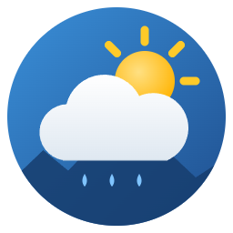

**All of Swiss weather in Home Assistant, in one integration.**
Official MeteoSwiss data, ready-made cards, nothing to program — in **German, French, Italian, Romansh and English**.

## Ready to use — no YAML, ever

**Install, pick your station, add a card. That's it.** Every card is set up with a few clicks in the visual editor: clear sections with a summary of what is on, a ↺ button to go back to the defaults, a link to the right page of this guide. No code, no YAML, no template — and it speaks your Home Assistant language.

<table><tr>
<td width="38%" valign="top">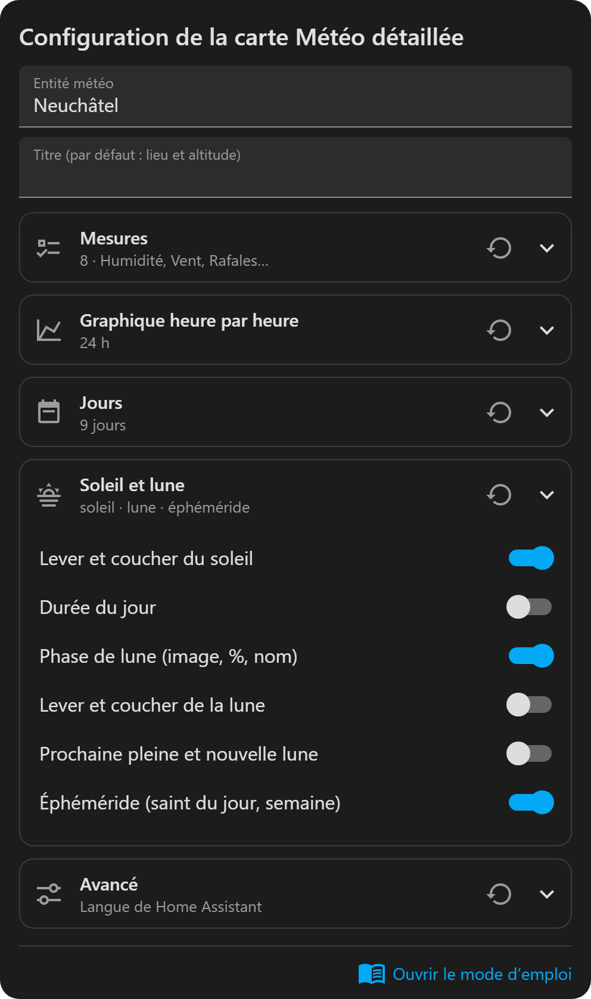</td>
<td valign="top">

- ✅ **Works out of the box**: station, forecast point, pollen station and avalanche region are found for your home.
- 🖱️ **Everything in the editor**: tick the measurements you want, drag them in order, switch the chart, the days, the sun and the moon on or off.
- 🔔 **Automations from menus**: *Rain arrives soon*, *First frost*, *Fog clears*, *Thunderstorm warning announced*… pick a trigger, no YAML.
- 🌍 **5 languages** follow Home Assistant by themselves (German, French, Italian, Romansh, English).
- 🎨 **Looks great everywhere**: phone, tablet, wall screen, light and dark.

</td></tr></table>

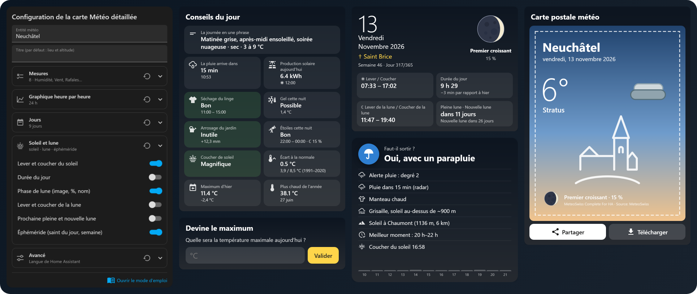

<sub>Example values.</sub>

🇫🇷 **[Mode d'emploi en français](https://github.com/SashConnection/meteoswiss4HA/blob/main/docs/GUIDE.fr.md)**

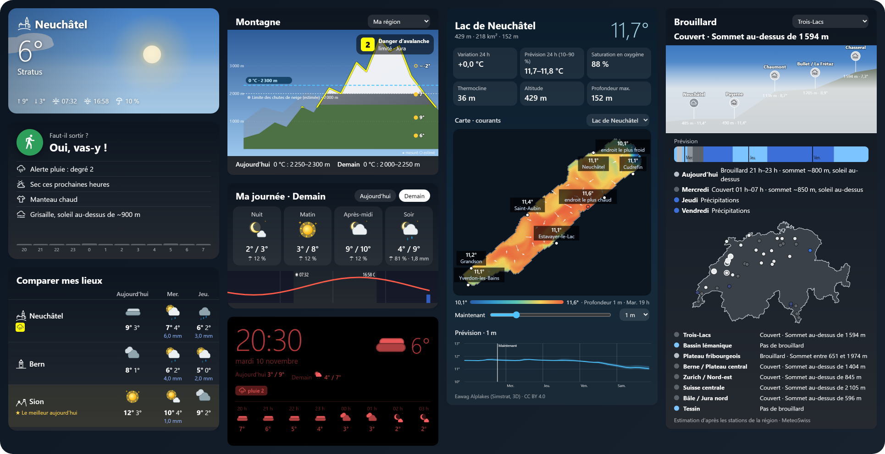

<sub>Lake and fog: real data of 10 November 2026 (Eawag Alplakes, MeteoSwiss stations). Other values are examples.</sub>

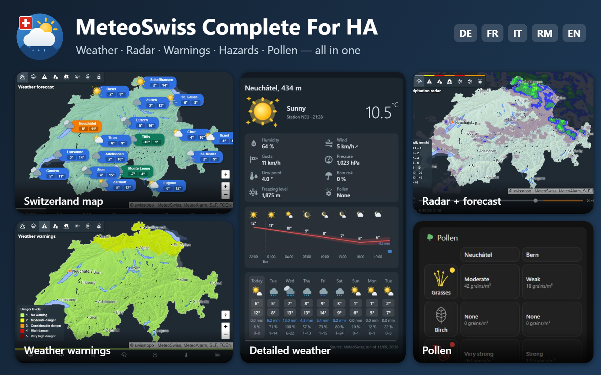

## Everything in one

| | |
|---|---|
| 🌤️ **Weather** | Current conditions from the nearest station, forecast for 9 days and hour by hour |
| 🌧️ **Radar** | The last 3 hours of the MeteoSwiss radar, then the rain forecast for the next 12 hours |
| ⚠️ **Weather warnings** | Rain, thunderstorms, wind, snow, slippery roads, heat, frost — official MeteoSwiss warnings |
| 🔥 **Natural hazards** | Forest fire, floods, drought (FOEN) and avalanches (SLF) |
| 🌼 **Pollen** | 7 species, 15 measuring stations across Switzerland |
| 🗺️ **Switzerland map** | All of the above on one map, or zoomed on your region |
| 📍 **Your places** | Warnings for other places (e.g. Bern, Cernier) and **where you are** (follows your phone), with ready-made automation triggers; compare them side by side |
| 🌫️ **Fog by region** | Sea of fog detected with reference stations from the plain to the summits (Neuchâtel → Chaumont → Chasseral), estimated top and 3-day forecast, triggers "fog forms / clears" |
| 🏞️ **Lakes** | 27 Swiss lakes: water temperature with a 4-day forecast, oxygen, thermocline, ice, depth profile; 13 lakes drawn in color with their currents (Eawag) |
| 🏔️ **Mountain** | 0 °C level, snow line, temperatures by altitude, sea of fog and avalanche danger — your region, a large region or all of Switzerland |
| 🧥 **Every day** | *Should I go out?*, *My day*, a live animated sky and a wall screen with a dark red night mode |
| 🌧️ **Rain in 20 minutes** | The radar tells when the rain reaches your home, with a ready-made trigger |
| 💡 **Tips of the day** | Laundry drying, frost tonight, garden watering, stars, sunset, rainbow, foehn, bise, airing — and the day in one sentence |
| ☀️ **Solar forecast** | Your panels' production today and tomorrow, hour by hour (just enter their power) |
| 🌙 **Sun, moon, ephemeris** | Sunrise, sunset, day length, moon phase drawn exactly (%, name), saint of the day — in every card you want |
| 📈 **History** | Yesterday, the 1991–2020 normal, the records of the year, first frost and first snow of the season |
| 🎁 **Fun** | A weather postcard to share, a "guess the maximum" game, a badge for the header, a color for your lights |

## Ready-made cards

<table>
<tr>
<td width="50%" valign="top">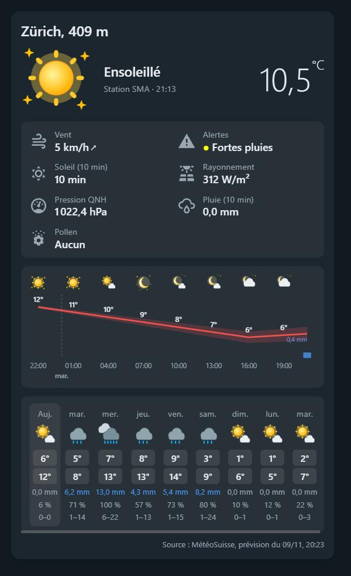<br><b>Detailed weather</b><br><sub>Your place and altitude, the measurements you choose, hourly chart, 9 days</sub></td>
<td width="50%" valign="top">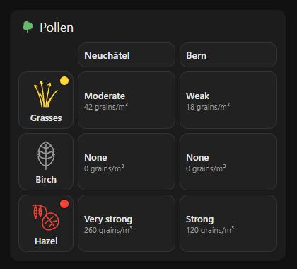<br><b>Pollen</b><br><sub>A sketch of each plant, colored by the pollen level, for the stations you choose</sub>
<br><br>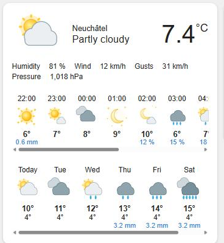<br><b>Forecast</b><br><sub>Compact current weather, hours and days</sub></td>
</tr>
<tr>
<td valign="top">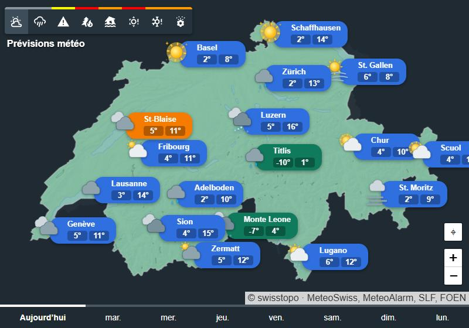<br><b>Switzerland map</b><br><sub>Weather, radar, warnings, hazards and pollen — one tap to switch</sub></td>
<td valign="top">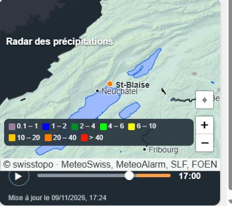<br><b>Map of your region</b><br><sub>Any layer, zoomed on your home (here: radar over Neuchâtel)</sub></td>
</tr>
<tr>
<td valign="top">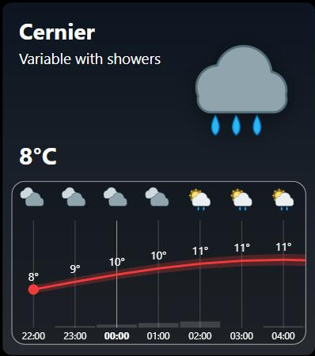<br><b>Now</b><br><sub>Big pictogram and the next hours: temperature with its uncertainty band, rain probability and amount</sub></td>
<td valign="top">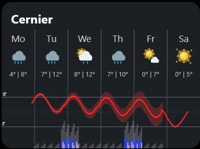<br><b>Days</b><br><sub>One continuous temperature curve and rain over the next days</sub>
<br><br>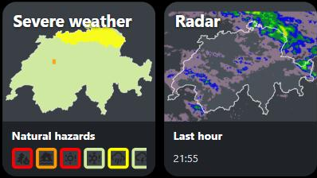<br><b>Tiles</b><br><sub>Severe weather mini map with hazard chips, animated radar</sub></td>
</tr>
<tr>
<td width="50%" valign="top">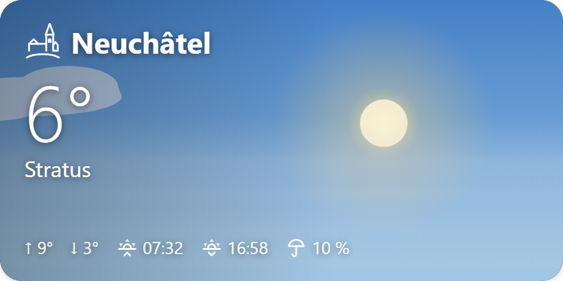<br><b>Live sky</b><br><sub>Sun or moon on its arc, drifting clouds, rain, snow, fog banks and stars — the weather of the moment, alive</sub></td>
<td width="50%" valign="top">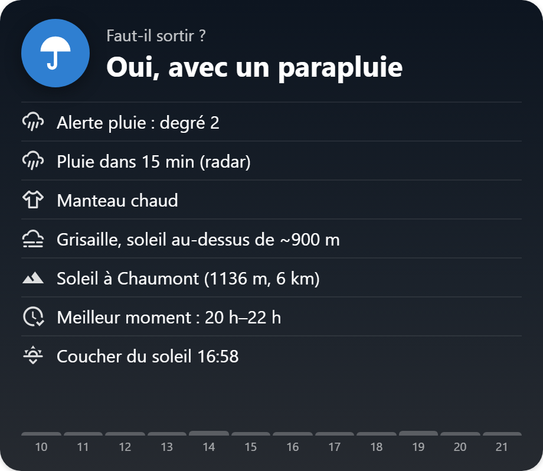<br><b>Should I go out?</b><br><sub>A clear verdict, when the rain starts, what to wear, gusts, warnings, pollen, fog, the best time</sub></td>
</tr>
<tr>
<td width="50%" valign="top">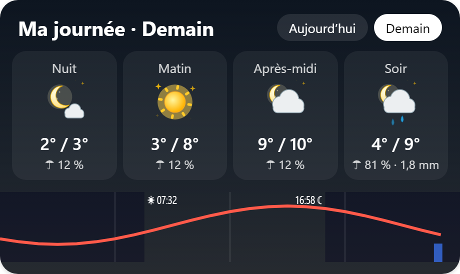<br><b>My day</b><br><sub>Night, morning, afternoon, evening, with the temperature curve, sunrise and sunset</sub></td>
<td width="50%" valign="top">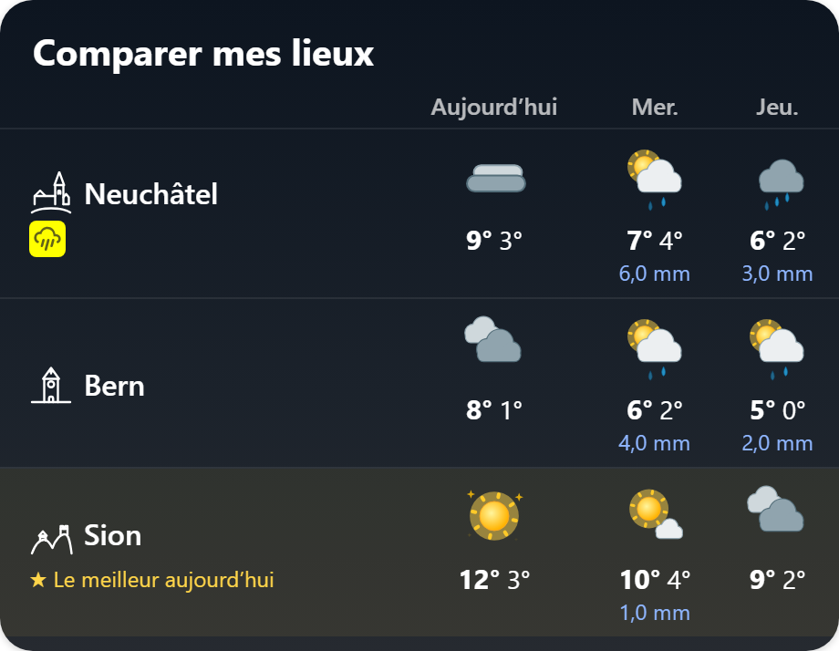<br><b>Compare my places</b><br><sub>Home and your watched places (e.g. Bern) side by side, with the best place today</sub></td>
</tr>
<tr>
<td width="50%" valign="top">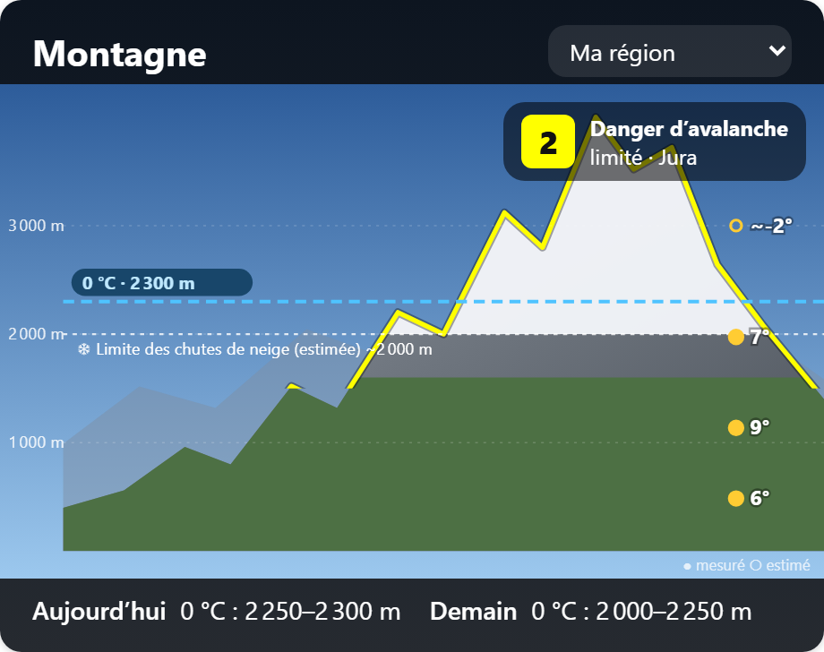<br><b>Mountain</b><br><sub>0 °C level, snow line, temperatures by altitude (measured and estimated), sea of fog, avalanche danger of your region, a large region or all of Switzerland</sub></td>
<td width="50%" valign="top">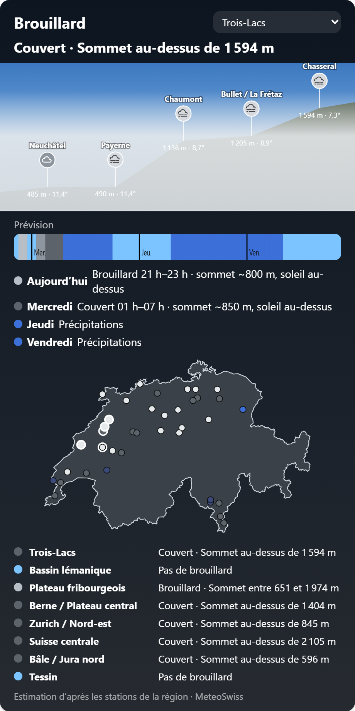<br><b>Fog by region</b><br><sub>Reference stations from the plain to the summits (Neuchâtel, Chaumont, Chasseral…), top of the fog, 3-day forecast, map of Switzerland</sub></td>
</tr>
<tr>
<td width="50%" valign="top">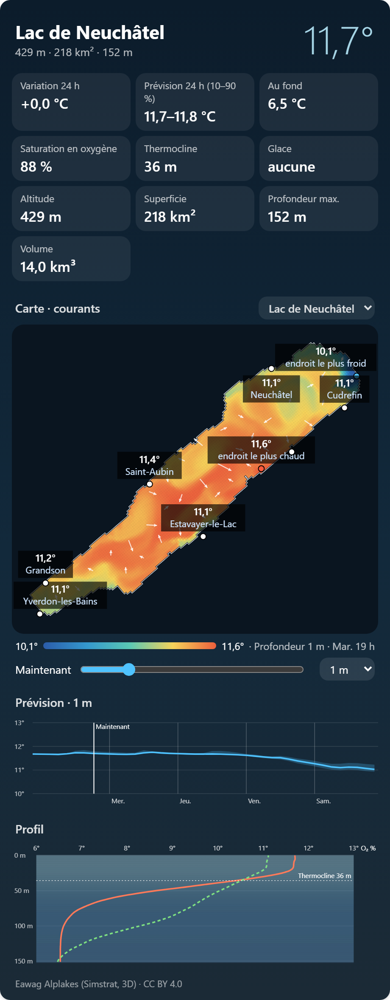<br><b>Lakes</b><br><sub>27 lakes: water temperature and forecast, oxygen, thermocline, ice, depth profile; 13 lakes drawn in color with currents and the lakeside towns</sub></td>
<td width="50%" valign="top">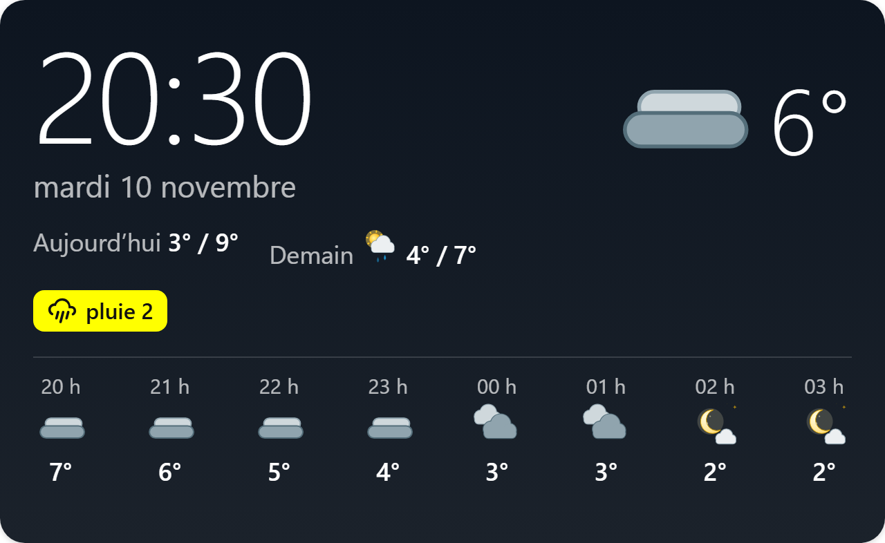<br><b>Wall screen</b><br><sub>Big clock, weather, next hours and warnings for a wall tablet</sub><br><br>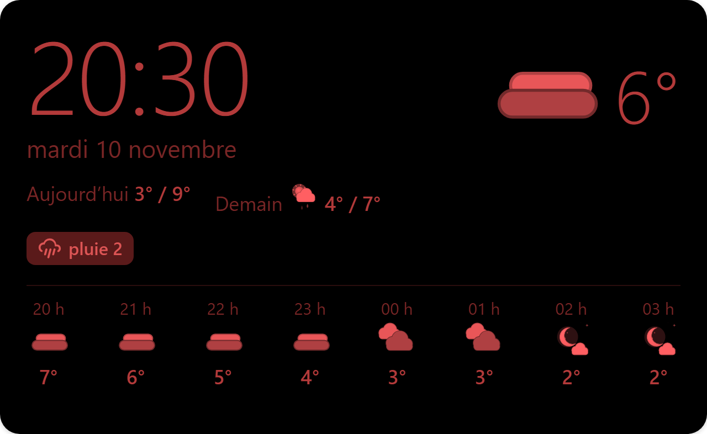<br><b>…and its night mode</b><br><sub>Dark red at night, so it does not light up the room</sub></td>
</tr>
</table>

Add them with **Edit dashboard → Add card → search "MeteoSwiss"**. Every setting is in the card editor, in clear sections: **no YAML needed, ever**. The YAML examples in this guide are only for those who like it.

## Everything you find in the cards

Add them with **Edit dashboard → Add card → "MeteoSwiss"**; then everything is set with the mouse.

| Card | What it shows | One-click settings |
|---|---|---|
| 🌤️ **Detailed weather** | Place and altitude, pictogram, condition, temperature, station and measuring time, hourly chart (uncertainty band, rain), 9 days (rain, probability, range) | Measurements and their order, chart, days, sun and moon |
| 📅 **Forecast** | Current weather, next hours and days with the animated pictograms | Hours and/or days, how many, details, sun and moon |
| 🕒 **Now** | Big pictogram, place, temperature, next hours | Chart, hours, sun and moon |
| 📈 **Days** | One continuous temperature curve and rain over several days | Number of days, sun and moon |
| ☁️ **Live sky** | The sky of the moment, animated: sun or moon (real phase), clouds, rain, snow, lightning, fog, stars | Animation, dashboard background, sun and moon |
| 🚶 **Should I go out?** | Verdict, rain timing (radar), what to wear, gusts, warnings, pollen, fog and the summit in the sun, best time | Number of hours |
| 🗓️ **My day** | Night, morning, afternoon, evening, temperature curve, sunrise and sunset | Sun and moon |
| 📍 **Compare my places** | Home and your watched places side by side, best place today | Number of days |
| 🖥️ **Wall screen** | Big clock, date, weather, today and tomorrow, warnings, next hours, dark red night mode | Night mode, seconds, hours, sun and moon |
| 🏔️ **Mountain** | 0 °C level, snow line, temperatures by altitude, sea of fog, avalanche danger | Avalanche region, altitude |
| 🌫️ **Fog** | Reference stations from the plain to the summits, fog top, 3-day forecast, map | Region, forecast, map, all regions |
| 🏞️ **Lake** | Water temperature, forecast, oxygen, thermocline, ice, profile, color map with currents and towns | Lake, values, map, depth, charts |
| 🌼 **Pollen** | A sketch of each plant colored by the level, for the stations you choose | Stations, species, layout |
| 🗺️ **Switzerland map** | Weather, radar, radar forecast, warnings, forest fire, floods, drought, avalanches, pollen | Layers, area, zoom, legend, height |
| 🧩 **Tiles** | Severe weather mini map with hazard chips, animated radar | Page opened on tap |
| 💡 **Tips of the day** | The day in one sentence, rain in … min, solar, laundry, frost, watering, stars, sunset, rainbow, foehn, bise, airing, normal, yesterday, records, first frost and snow | Tiles and their order |
| 🌙 **Ephemeris** | Date, saint of the day, week, sunrise and sunset, day length, moon drawn (%, name), moonrise and moonset, next full and new moon | — |
| 💌 **Postcard** | Your town's monument, the weather and the moon, to share or download | Place |
| 🎯 **Guess the maximum** | Bet on the maximum temperature, result in the evening, streak | — |
| 🏷️ **Badge** | Pictogram and temperature at the top of a dashboard, "☂ Rain in 15 min" | Rain alert |

### The moon, drawn for the exact day

The moon is not a stock icon: it is **drawn for the exact phase of the day**, the lit part at the right percentage, with craters and the dark side in night blue. It appears in the ephemeris, in the cards' "Sun and moon" section, in the live sky and on the postcard, with the **phase name in your language** and the **% illuminated**.

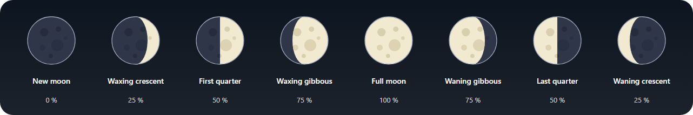

## A monument for every town

Each town of the map has its own line pictogram of its best-known monument — the Zytglogge in Bern, the Jet d’eau in Geneva, the Kapellbrücke in Lucerne, the Matterhorn in Zermatt… They appear on the map labels and next to the place name in the cards (option `monument: false` to hide them).

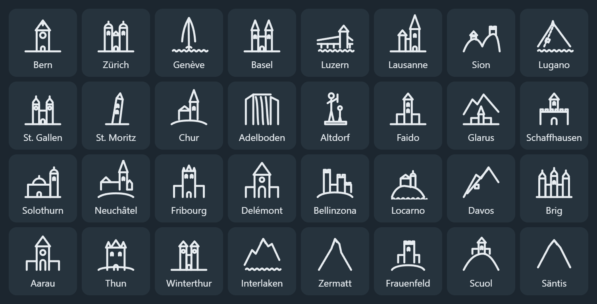

## Five languages

Everything — settings, entities, cards and map — speaks **Deutsch, Français, Italiano, Rumantsch and English**. By default the cards follow the Home Assistant language; each card can also be set to another one.

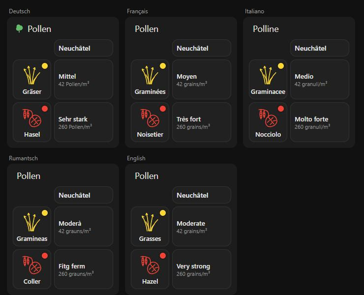

## Animated or static — your choice

Three pictogram packs, one per MeteoSwiss weather symbol. Pick one in the integration options; the animated pack is the default.

<p>


</p>

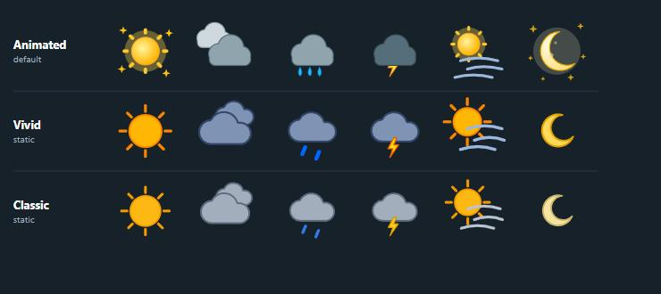

## Ready in 2 minutes

1. **HACS** → ⋮ → Custom repositories → `https://github.com/SashConnection/meteoswiss4HA` (Integration) → Download → restart Home Assistant.
2. **Settings → Devices & services → Add integration → MeteoSwiss Complete For HA**: pick your station and postal code (the nearest are suggested).
3. **Add a card** to your dashboard: search "MeteoSwiss".

> Screenshots: Neuchâtel and Bern; lake and fog cards show real data of 10 November 2026, some other values (forecasts, pollen) are examples.

---

# User guide

## Contents

1. [Installation](#1-installation)
2. [Settings](#2-settings)
3. [Forecast card](#3-forecast-card) · [Tips, sun and moon](#3h-tips-of-the-day-sun-and-moon-and-more) · [Everyday panels](#3d-everyday-panels) · [Mountain](#3e-mountain) · [Fog by region](#3f-fog-by-region) · [Lakes](#3g-lakes)
4. [Switzerland map](#4-switzerland-map)
5. [One map per hazard, or zoomed on your region](#5-one-map-per-hazard-or-zoomed-on-your-region)
6. [On a phone](#6-on-a-phone)
7. [Entities for your automations](#7-entities-for-your-automations)
8. [Updates and versions](#8-updates-and-versions)
9. [Troubleshooting](#9-troubleshooting)
10. [Technical notes](#10-technical-notes)
11. [Data sources and license](#11-data-sources-and-license)

---

## 1. Installation

Requires Home Assistant **2026.1** or newer and [HACS](https://hacs.xyz).

1. In HACS, open the menu **⋮ → Custom repositories**.
2. Add `https://github.com/SashConnection/meteoswiss4HA`, category **Integration**.
3. Search for **MeteoSwiss Complete For HA**, click **Download**, then **restart Home Assistant**.
4. **Settings → Devices & services → Add integration**, search for **MeteoSwiss Complete For HA**.
5. Choose:
   - the **weather station** (sorted from nearest to farthest from your home): it gives the current temperature, wind, etc.;
   - the **postal code** used for the local forecast.

The integration creates a weather entity and sensors, and adds two cards for your dashboards.

## 2. Settings

**Settings → Devices & services → MeteoSwiss Complete For HA → Configure**. The menu has six pages:

| Page | Settings |
|---|---|
| **Display** | Pictogram pack: **Animated** (default), **Vivid** or **Classic**. Option **"Show the map page in the sidebar"** (off by default). |
| **Forecast** | Hourly forecast on/off, horizon (48 h by default) and refresh interval. MeteoSwiss hourly files are large: reduce the horizon to save bandwidth. |
| **Pollen and hazards** | Pollen station and avalanche region. "Automatic" picks the one nearest to your home. |
| **Lakes and fog** | The lakes that get a water temperature sensor (default: the lake nearest to your home, if within 15 km) and **fog by region** (on by default). |
| **Rain alert, solar and indoor** | Rain alert from the radar (and how many minutes in advance), your solar panels (power, tilt, orientation) and indoor sensors (airing). |
| **Watched places and persons** | Postal codes or places, and persons to follow (see [3c](#3c-warnings-for-your-places-and-where-you-are)). |

The integration reloads by itself after a change.

## 3. Forecast card

The standard Home Assistant weather card always uses its own icons. To see **our pictograms** (animated by default), use the **MeteoSwiss forecast** card:

**Edit dashboard → Add card → search for "MeteoSwiss forecast"**.

| Hours and days | Days only, no details |
|---|---|
|  | 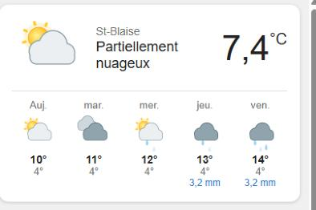 |

- **Top**: current weather (pictogram, sky condition, measured temperature) and details (humidity, wind, gusts, pressure). A click opens the entity dialog.
- **Middle**: the next hours (time, pictogram, temperature, rain in mm or probability in %). Scroll to the right.
- **Bottom**: the next days (minimum, maximum, rain).

Settings in the card editor, or in YAML:

```yaml
type: custom:meteoswiss-forecast-card
entity: weather.home  # optional: the first MeteoSwiss weather entity
forecast: both        # both = hours and days, daily, hourly or none
days: 7               # 1 to 9
hours: 12
show_current: true    # current weather
show_details: true    # humidity, wind, pressure
```

The hourly part needs the **hourly forecast** turned on (Forecast settings page).

### Detailed weather card


The **MeteoSwiss detailed weather** card shows everything at once:

- place and altitude, pictogram, condition, measuring station and time, temperature;
- a grid of **measurements you choose one by one, in the order you want** (tick and drag them in the card editor);
- an **hourly chart**: pictograms, temperature with its 10–90 % uncertainty band, precipitation bars, day separators;
- **9 days**: pictogram, minimum and maximum, precipitation, rain probability and precipitation range (10–90 %);
- the forecast run time.

Measurements available: humidity, wind, gust, pressure, dew_point, precipitation_probability, freezing_level, pollen, precipitation, sunshine, global_radiation, pressure_qnh, pressure_qfe, warnings.

```yaml
type: custom:meteoswiss-weather-card
details: [humidity, wind, gust, pressure, dew_point, precipitation_probability, freezing_level, pollen]
show_header: true
show_chart: true
hours: 24             # 6 to 48
show_daily: true
days: 9
```

<br clear="right">

### Pollen card


The **MeteoSwiss pollen** card shows, for each species you choose, a **sketch of the plant** that takes the color of the pollen level as soon as there is pollen, and for each station you choose the **level and the concentration** (24-hour mean or last hour). Layout: **table** (stations as columns) or **list**. Languages: de, fr, it, rm, en.

```yaml
type: custom:meteoswiss-pollen-card
stations: [PNE, PBE]  # Neuchâtel, Bern (default: the station of the integration)
species: [grasses, birch, hazel]
layout: table         # or list
value: mean           # or latest
language: auto        # or de, fr, it, rm, en
```

<br clear="right">

## 3b. Now, Days and Tiles cards

| Now | Days | Tiles |
|---|---|---|
|  |  |  |

```yaml
type: custom:meteoswiss-now-card     # big pictogram + hour-by-hour chart
hours: 24
---
type: custom:meteoswiss-days-card    # days above one continuous curve
days: 6
---
type: custom:meteoswiss-tiles-card   # severe weather mini map + animated radar
tap_path: /meteoswiss                # page opened on tap
```

The Days curve uses the hourly forecast where it exists (48 h by default) and continues through the daily minimum and maximum; set the hourly horizon to 120 h in the options for a full hourly curve.

## 3c. Warnings for your places and where you are

**Settings → Devices & services → MeteoSwiss Complete For HA → Configure → Watched places and persons**:

- **Postal codes or places**: e.g. `2053` or `Cernier`, `3000` or `Bern` (the nearest forecast point is used);
- **Persons to follow**: a person or the device tracker of your phone (Home Assistant app). The warnings follow its position (in Switzerland).

Each one becomes a device (e.g. *MeteoSwiss Bern (3004)*) with the 7 weather warning sensors.

### Ready-made automation triggers

**Settings → Automations → Create → Add trigger → Device →** a MeteoSwiss device, then choose:

- *Thunderstorm warning announced* (an upcoming warning is published),
- *Rain warning starts* / *ends*,
- *Wind warning reaches a level* (2 to 5),
- on the main device also: *Forest fire / Flood / Drought / Avalanche danger reaches a level*, *Pollen reaches a level*, *Fog or low stratus forms*, *The fog clears*.

Example: notify your phone when a thunderstorm warning is announced where you are — no YAML needed.

## 3d. Everyday panels

| | |
|---|---|
|  |  |
|  |  |

- **Live sky** (`meteoswiss-sky-card`): the sky of the moment drawn and animated behind the place and the temperature — sun or moon on its arc between sunrise and sunset, clouds drifting with the wind, rain, snow, lightning, fog banks, stars. `animate: false` for a still picture (also when the device asks for reduced motion).
- **Should I go out?** (`meteoswiss-outing-card`): a verdict (*Yes, go!*, *with an umbrella*, *better later*, *better stay in*) and the reasons: when the rain starts, what to wear for the temperature and the wind, gusts, warnings in force, pollen, fog with the sunshine altitude, the best 2-hour window, sunset. `hours: 12`.
- **My day** (`meteoswiss-day-card`): night, morning, afternoon and evening with their pictogram, temperatures and rain, above the temperature curve with sunrise and sunset. Today / Tomorrow buttons (tomorrow first after 18:00).
- **Compare my places** (`meteoswiss-compare-card`): home and every watched place, 1 to 5 days, warnings in force, and ★ the best place today (driest, then warmest). Add places in the options (*Watched places and persons*).
- **Wall screen** (`meteoswiss-wall-card`): big clock, date, temperature, today and tomorrow, warnings and the next hours. `night_mode: auto` turns everything dark red once the sun has set (`on` / `off` to force it).

```yaml
type: custom:meteoswiss-outing-card
hours: 12
---
type: custom:meteoswiss-wall-card
night_mode: auto        # auto (sun), on, off
hours: 8
show_seconds: false
```

## 3e. Mountain


A generic mountain (no names) up to 4,000 m with:

- the **0 °C level** of the local forecast, and its range today and tomorrow;
- the **snow line** when precipitation is expected (≈ 300 m below the 0 °C level, *estimated*);
- **temperatures by altitude**: ● *measured* by a station near you at that altitude (e.g. Chaumont, Chasseral, Moléson), ○ *estimated* between your temperature and the 0 °C level where no station exists;
- the **sea of fog** of your region (see below);
- the **avalanche danger**, with a menu: *my region*, a large region (*Jura, Prealps, Bernese Alps, Valais Alps, Central Switzerland, Northern Grisons, Engadine, Southern Alps*) or *all of Switzerland* (highest level).

```yaml
type: custom:meteoswiss-mountain-card
avalanche_scope: home    # home, switzerland, jura, prealps, bernese, valais, central, grisons, engadine, south
max_altitude: 4000
```

<br clear="right">

## 3f. Fog by region


MeteoSwiss has no "fog top" measurement, so the integration **reads it from the stations**: each region has a ladder of stations from the plain to the summits. A station is *in the fog* when it gets no sun and the air is saturated; a station is *above* when it gets sun (by day) or dry air (by night). The top lies between the two.

| Region | Plain | Hills and summits |
|---|---|---|
| Three Lakes | Neuchâtel 485 m, Payerne 490 m | Chaumont 1136 m, La Frétaz 1205 m, Chasseral 1594 m |
| Lake Geneva | Geneva 411 m, Changins 458 m, Pully 456 m | Bière 684 m, La Dôle 1670 m |
| Fribourg plateau | Payerne 490 m, Grangeneuve 651 m | Plaffeien 1042 m, Moléson 1974 m |
| Bern / Central Plateau | Wynau 422 m, Bern 553 m | Bantiger 942 m, Napf 1404 m |
| Zurich / North-east | Kloten 426 m, Tänikon 539 m, Zurich 604 m | Lägern 845 m, Uetliberg 854 m, Hörnli 1133 m, Säntis 2501 m |
| Central Switzerland | Lucerne 454 m, Mosen 453 m, Egolzwil 522 m | Einsiedeln 911 m, Pilatus 2105 m |
| Basel / North Jura | Basel 316 m, Delémont 439 m | Fahy 596 m, Rünenberg 611 m |
| Ticino | Magadino 203 m, Lugano 273 m, Locarno 367 m | Monte Generoso 1600 m, Cimetta 1661 m |

- **Now**: every 10 minutes from the measurements (sunshine, humidity, dew point, precipitation).
- **Forecast**: hour by hour for 3 days from the local forecast of the same stations (symbols *stratus* and *fog*, low cloud cover, sunshine duration), summed up by day: *Wednesday: low stratus 6–14 h, top ~1,000 m, sunshine above*.
- **Sensors**: `sensor.<location>_fog` (no fog, fog, low stratus, overcast, precipitation; attributes: region, `top_min`, `top_max`, stations, forecast) and `sensor.<location>_fog_top` (estimated top, m).
- **Triggers**: *Fog or low stratus forms* / *The fog clears*.

```yaml
type: custom:meteoswiss-fog-card
region: three_lakes     # default: your region
show_forecast: true
show_map: true
show_all: false         # list of every region
```

The forecast reads three MeteoSwiss hourly files every 6 hours (~90 MB); turn fog off in *Lakes and fog* to save bandwidth.

<br clear="right">

## 3g. Lakes


Data from the **Eawag Alplakes** lake models (CC BY 4.0), for 27 lakes: Geneva, Constance, Neuchâtel, Maggiore, Lucerne, Zurich, Lugano, Thun, Biel, Zug, Brienz, Walen, Murten, Sempach, Hallwil, Gruyère, Joux, Greifen, Sarnen, Ägeri, Baldegg, Sils, Pfäffikon, Silvaplana, Lungern, Poschiavo, St. Moritz.

- **Values you choose** (`measures`): water temperature at 1 m, change over 24 h, next 24 h range (10–90 %), temperature at the bottom, oxygen saturation, thermocline depth, ice, altitude, area, maximum depth, volume.
- **Map** for the 13 lakes with a 3D model (Geneva, Neuchâtel, Biel, Murten, Zurich, Zug, Lucerne, Lugano, Joux, Hallwil, Greifen, Ägeri, St. Moritz): the lake drawn in color by temperature, **currents** as arrows, the **lakeside towns** with the water temperature in front of them, the warmest and coldest spots. A slider goes from yesterday to +4 days; the depth menu shows 1 to 50 m.
- **Forecast** at 1 m with its 10–90 % range, and the **profile** from the surface to the bottom (temperature, oxygen, thermocline).
- **Sensors**: one `Water temperature <lake>` sensor per lake chosen in *Lakes and fog*, with the forecast and all values as attributes — e.g. "notify me when Lake Neuchâtel reaches 20 °C".

```yaml
type: custom:meteoswiss-lake-card
lake: neuchatel
measures: [trend, range, bottom, oxygen, thermocline, ice, altitude, area, max_depth, volume]
show_map: true
show_forecast: true
show_profile: true
depth: 1
```

<br clear="right">

## 3h. Tips of the day, sun and moon, and more

### Tips of the day

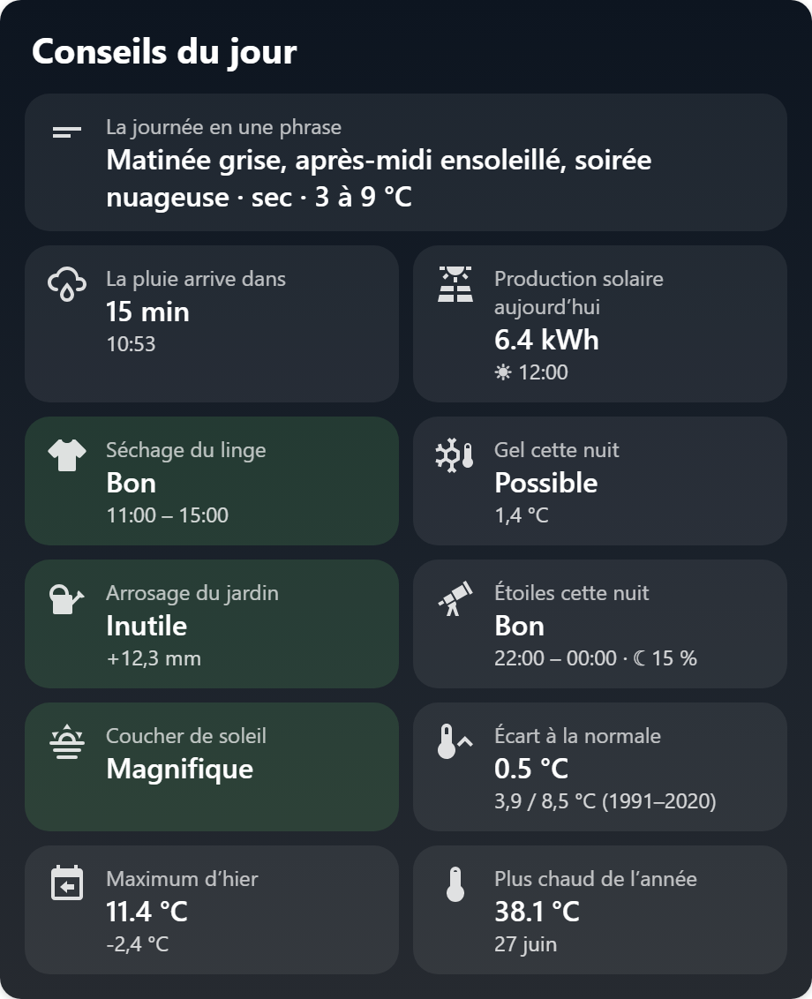

One card, the tiles you choose: **the day in one sentence**, **rain in … minutes** (radar), **solar production** today and tomorrow, **laundry drying** (best time), **frost tonight** (plants and windscreen), **garden watering** (water balance of the last 5 days), **stars tonight** (clouds and moon), **sunset** (colorful or dull), **rainbow** (possible right now), **foehn**, **bise**, **airing** (indoor vs outdoor humidity), **vs the 1991–2020 normal**, **yesterday**, **records of the year**, **first frost** and **first snow**. Good news is shown in green. Tap a tile for its details.

Each tip is also a sensor for your automations, and several have a ready-made trigger: *Rain arrives soon*, *First frost of the season*, *First snow*, *Rainbow possible*, *Beautiful sunset expected*, *Foehn blows*, *Bise blows*.

<br clear="right">

### Sun, moon and ephemeris

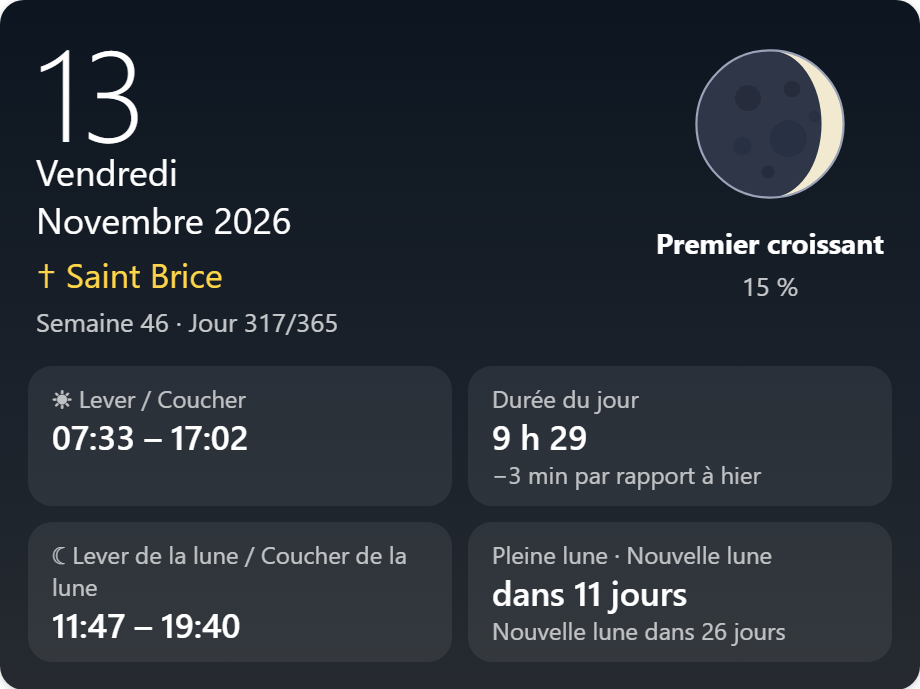

In the editor of the weather, forecast, now, days, my day, sky and wall cards, the **Sun and moon** section adds: sunrise and sunset, day length (and the change since yesterday), the **moon phase drawn for the exact day** with its % and name, moonrise and moonset, next full and new moon, and the **ephemeris** (saint of the day, week and day number) — in the language of the card. The **Ephemeris** card shows all of it at once.

Sensors: *Moon phase*, *Day length*, *Saint of the day*.

<br clear="right">

### Rain arriving, solar panels, airing

**Settings → Devices & services → MeteoSwiss Complete For HA → Configure → Rain alert, solar and indoor**:

- **Rain alert**: on by default; choose how many minutes in advance (20 by default). The sensor *Rain arrives in* gives the minutes, and the *Rain arrives soon* trigger notifies you in time to bring the laundry in.
- **Solar panels**: enter the peak power (kWp), tilt and orientation — the sensors *Solar production today / tomorrow* give the kWh and the best hour, hour by hour in their attributes. Perfect to start the dishwasher or charge the car at the right time.
- **Indoor sensors**: choose your indoor temperature and humidity sensors; *Airing* tells when opening the windows dries the house.

### Postcard, guessing game, badge, ambiance color, dashboard background

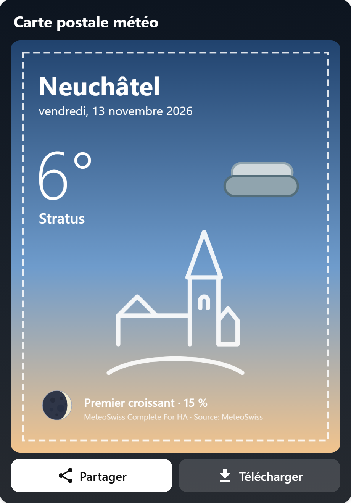

- **Weather postcard** (`meteoswiss-postcard-card`): your town's monument, the weather of the moment and the moon on a postcard — **Share** (phone) or **Download**.
- **Guess the maximum** (`meteoswiss-guess-card`): guess today's maximum, see the measured result in the evening, keep your streak.
- **Badge** (`meteoswiss-badge`): the pictogram and the temperature at the top of a dashboard, with "☂ Rain in 15 min" when it is coming.
- **Ambiance color**: the sensor gives a color for the weather and time of day (`rgb_color` attribute) for a smart light.
- **Dashboard background**: the live sky card with *As dashboard background* draws the animated sky behind your cards (use a theme with a transparent view background).

<br clear="right">

## 4. Switzerland map

Add the **MeteoSwiss map** card to a dashboard (or turn on the sidebar page, see [Settings](#2-settings)). The toolbar at the top left switches maps; the **colored line** above each button shows the highest danger level currently in force in Switzerland.

Buttons under the zoom: **⌖** re-centers the map, **+ / −** zoom.

### Weather

Pictogram, minimum and maximum for 31 towns and a few summits (green); your home is orange (see "At a glance" at the top). The tabs at the bottom choose the day. More places appear when you zoom in.

### Precipitation radar

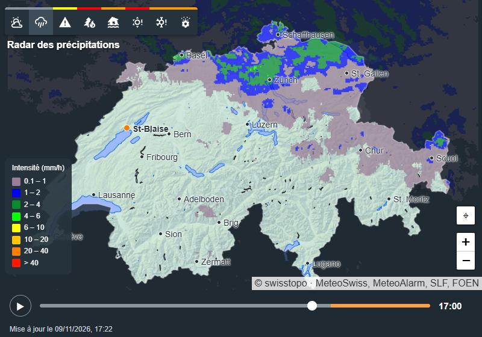

The **last 3 hours** of the MeteoSwiss radar, one image every 5 minutes, then the **hourly precipitation forecast** (**orange** part of the slider, labelled "Forecast"):

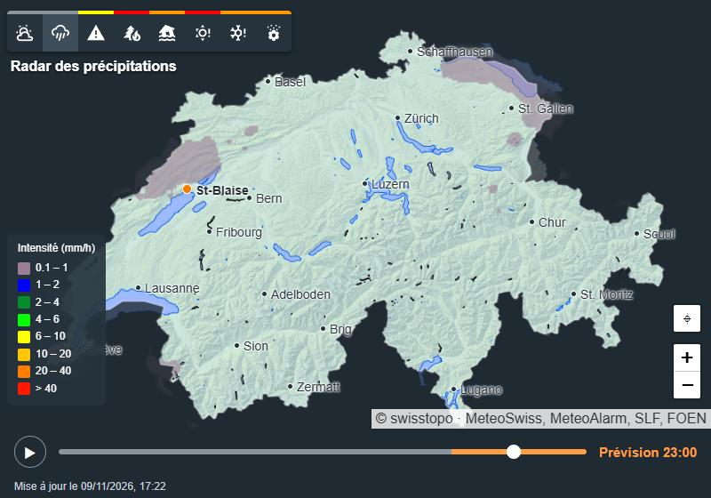

▶ / ❚❚ starts or stops the animation; the slider picks a time. If the radar server does not answer, the map says that the radar is not available for the moment.

### Weather warnings

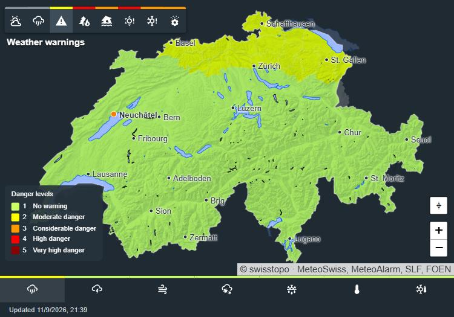

The official MeteoSwiss warnings: **rain, thunderstorms, wind, snow, slippery roads, heat, frost** (tabs at the bottom). Switzerland is green when there is no warning; warning regions take the color of their danger level. **Upcoming** warnings are dashed. Hover (or tap) a region to see the warning text, start and end.

### Forest fire, floods, drought

| Forest fire | Floods | Drought |
|---|---|---|
| 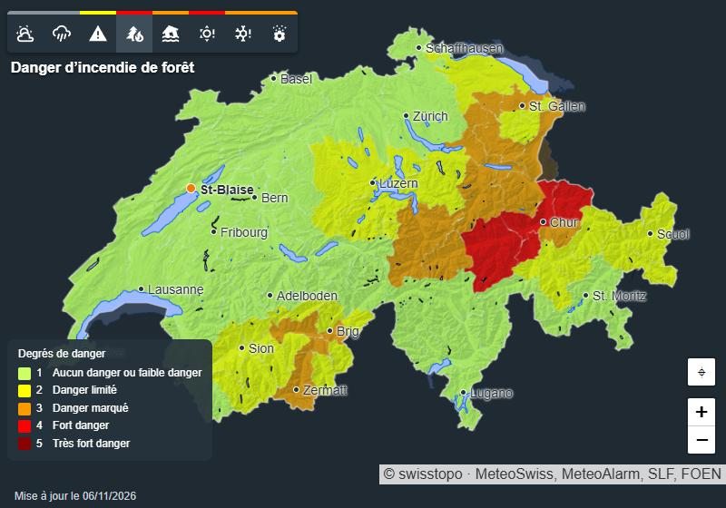 | 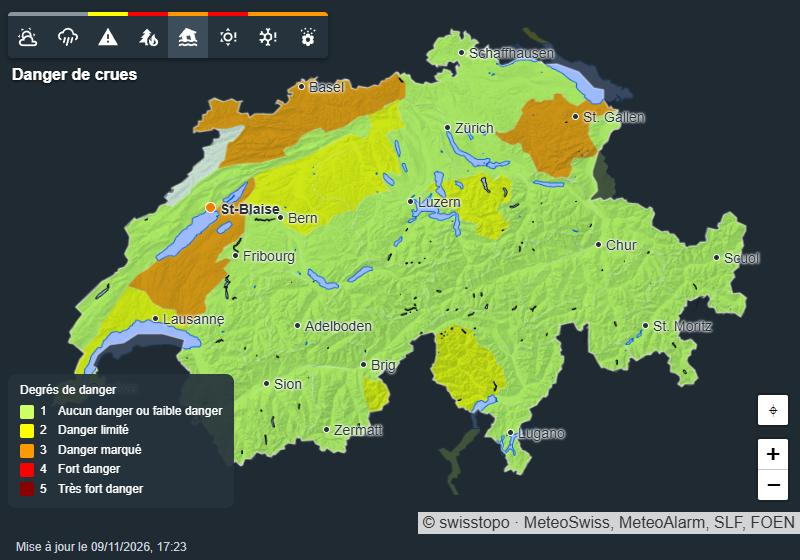 | 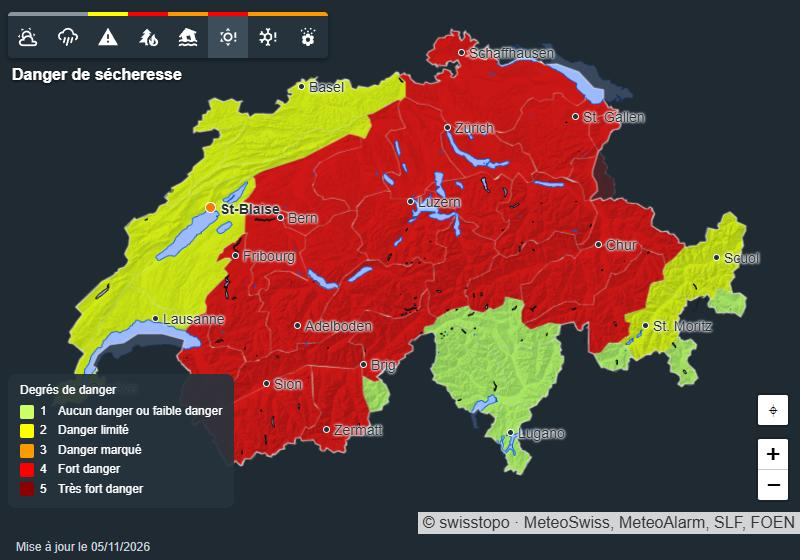 |

FOEN maps by region (and by river for floods). The **Avalanches** (SLF bulletin, in season) and **Pollen** (15 measuring stations) layers work the same way.

### Danger levels

| Level | Color | Meaning |
|---|---|---|
| 1 | green | No or low danger (no warning) |
| 2 | yellow | Moderate danger |
| 3 | orange | Considerable danger |
| 4 | red | High danger |
| 5 | dark red | Very high danger |

## 5. One map per hazard, or zoomed on your region

In the **MeteoSwiss map** card editor:

- **Layers shown**: tick **a single** hazard for a dedicated map without toolbar (you can put several on one dashboard);
- **Area**: **Whole Switzerland** or **My region (home)**, with a **zoom** level from 7 to 12;
- **Legend** on or off, map **height**.

| Forest fire only | Radar zoomed on home |
|---|---|
| 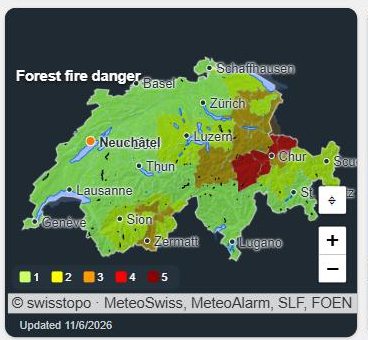 |  |

In YAML:

```yaml
type: custom:meteoswiss-map-card
layer: weather        # layer shown first
layers: [radar]       # one or more of: weather, radar, warnings, fire, flood, drought, avalanche, pollen
area: home            # switzerland (default) or home
zoom: 9
legend: true
height: 360
```

## 6. On a phone

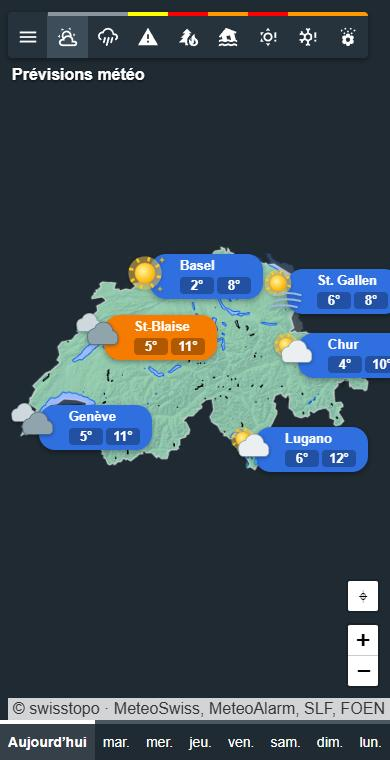

On a narrow screen the legend becomes one compact line and the tabs use icons. On the sidebar page, the ☰ button opens the Home Assistant menu.

## 7. Entities for your automations

| Entity | Content |
|---|---|
| `weather.<location>` | Current weather and daily/hourly forecast. Forecast items also carry `meteoswiss_symbol`; the `icons_url` attribute gives the pictogram pack URL. |
| `sensor.<location>_temperature`, `_humidity`, … | Station measurements (only those the station actually measures). |
| `sensor.<location>_meteoswiss_symbol` | Current MeteoSwiss symbol code (1–42 day, 101–142 night); its picture is the pictogram of the chosen pack. |
| `sensor.<location>_weather_description` | Official MeteoSwiss description in the Home Assistant language. |
| `sensor.<location>_rain_warning`, `_thunderstorm_warning`, `_wind_warning`, `_snow_warning`, `_slippery_roads_warning`, `_heat_warning`, `_frost_warning` | Warning in force at your home (`low` = no warning). Attributes: event, region, description, instruction, onset, expires, and `upcoming` for announced warnings. |
| `sensor.<location>_flood_danger`, `_forest_fire_danger`, `_drought_danger` | FOEN danger level of your region. |
| `sensor.<location>_avalanche_danger` | SLF avalanche danger of your region (or no bulletin off-season). |
| `sensor.<location>_pollen_level`, `_birch_pollen`, `_grass_pollen`, … | Overall pollen level and concentration per species. |
| `sensor.<location>_moon_phase`, `_day_length`, `_saint_of_the_day` | Moon phase (illumination, next full / new moon), day length (sunrise, sunset), saint of the day (week, day number). |
| `sensor.<location>_today_in_a_sentence`, `_ambiance_color` | The day in one sentence (Home Assistant language); a color for your lights (`rgb_color`). |
| `sensor.<location>_rain_arrives_in` | Minutes before the rain reaches home (radar). |
| `sensor.<location>_laundry_drying`, `_frost_tonight`, `_garden_watering`, `_stargazing_tonight`, `_sunset`, `_rainbow`, `_foehn`, `_bise`, `_airing` | Everyday tips (states translated), details as attributes. |
| `sensor.<location>_solar_production_today`, `_tomorrow` | Estimated kWh of your panels, hour by hour. |
| `sensor.<location>_temperature_vs_normal`, `_yesterday_s_maximum`, `_warmest_of_the_year`, `_coldest_of_the_year`, `_strongest_gust_of_the_year`, `_first_frost_of_the_season`, `_first_snow_of_the_season` | History of your station: normal 1991–2020, yesterday, records, first frost and snow. |
| `sensor.<location>_fog`, `_fog_top` | Fog / low stratus in your region and the estimated top (m). |
| `sensor.<location>_water_temperature_<lake>` | Water temperature of a lake (1 m), with forecast, oxygen, thermocline, ice and lake facts as attributes. |

Example: get notified as soon as a thunderstorm warning is announced.

```yaml
triggers:
  - trigger: state
    entity_id: sensor.home_thunderstorm_warning
    attribute: upcoming
conditions:
  - condition: template
    value_template: "{{ state_attr('sensor.home_thunderstorm_warning', 'upcoming') | count > 0 }}"
actions:
  - action: notify.notify
    data:
      message: "Thunderstorm warning announced: {{ state_attr('sensor.home_thunderstorm_warning', 'upcoming')[0].event }}"
```

The pictograms can also be used in any card: they are served at `/meteoswiss4ha/icons/<pack>/<code>.svg`, for example:

```yaml
type: picture-entity
entity: sensor.home_meteoswiss_symbol
```

## 8. Updates and versions

Versions follow the calendar: **YEAR.MONTH.N**, for example 2026.11.0, then 2026.11.1 for the next update in the same month, 2026.12.0 the following month. What changed in each version is in the [CHANGELOG](https://github.com/SashConnection/meteoswiss4HA/blob/main/CHANGELOG.md).

To update: HACS offers the new version → **Download** → **restart Home Assistant** → in the browser, **Ctrl+F5** to reload the cards.

## 9. Troubleshooting

| Problem | Solution |
|---|---|
| The cards did not change after an update | Ctrl+F5 in the browser; in the mobile app, *App settings → Debugging → Reload frontend*. |
| The map is off-center | **⌖** button under the zoom. |
| "The radar is not available at the moment" | The project's radar server does not answer; it recovers by itself, try again later. |
| No hourly forecast | Turn on the **hourly forecast** in the settings (Forecast page). |
| A warning or hazard is "unavailable" | Its source (MeteoSwiss/MeteoAlarm, FOEN, SLF) does not answer; the value comes back at the next update. |
| The fog card says "unavailable" | Turn on *Fog and low stratus by region* in *Lakes and fog*. |
| A lake card stays empty | The Eawag server limits the number of requests; the card retries at the next refresh. |

## 10. Technical notes

- **Bandwidth**: MeteoSwiss publishes one hourly forecast file per parameter for all ~5,800 points (~33 MB each). The integration streams them and stops once the requested horizon is reached (~8 MB per parameter for 48 h).
- **Fog**: the forecast reads three whole hourly files (low clouds, sunshine, symbol: ~90 MB) every 6 hours; the measurements come with the current conditions (no extra download). The top altitude is an estimate between two stations.
- **History and normals**: the station's daily values of the year (~50 kB, every 3 hours); the 1991–2020 normals are computed once a week from its full daily history (~6 MB).
- **Rain alert**: two radar images every 5 minutes (a few kB), compared around your home to follow the rain.
- **Sun and moon**: computed in Home Assistant and in the browser, nothing downloaded.
- **Lakes**: the Eawag Alplakes API is called once per hour per chosen lake, one request at a time; the cards' map layers are cached for 3 hours.
- **Radar**: the radar images and the precipitation forecast are prepared by a server run by the project (`ha.jesaispas.ch`) from MeteoSwiss data; Home Assistant downloads them from there. If this server does not answer, the map says the radar is not available for the moment.
- **Pictograms**: generated by `node scripts/generate_icons.mjs` (vivid and classic packs, `THEMES` / `SPEC`) and `scripts/animated_icons.mjs` (animated pack). The animations stop when the device asks for reduced motion.

## 11. Data sources and license

Data: **Source: MeteoSwiss** — Open Government Data under [CC BY 4.0](https://opendatadocs.meteoswiss.ch/general/terms-of-use). Symbol descriptions are the official MeteoSwiss texts.
Weather warnings: MeteoSwiss, published through [MeteoAlarm](https://meteoalarm.org) (EUMETNET, CC BY 4.0); they are not part of the MeteoSwiss Open Data catalogue. MeteoAlarm uses 4 colors, so MeteoSwiss levels 4 and 5 both show as level 4.
Natural hazards: FOEN (forest fire, floods, drought) and SLF (avalanches). Base map © swisstopo.
Lakes: [Eawag Alplakes](https://www.alplakes.eawag.ch) (Simstrat, MITgcm and Delft3D models), CC BY 4.0. Lake facts (altitude, area, depth, volume) are rounded reference values.
This project is not affiliated with or endorsed by MeteoSwiss. The pictograms are original artwork, not the official MeteoSwiss pictograms.

Code and pictograms: MIT License.
