# Mode d'emploi – MeteoSwiss Complete For HA

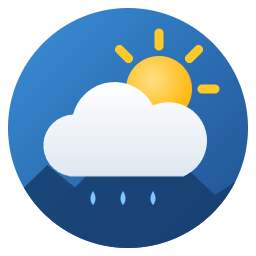

🇬🇧 **[English version](../README.md)**

**Toute la météo suisse dans Home Assistant, en une seule intégration.**
Données officielles de MétéoSuisse, cartes prêtes à l’emploi, rien à programmer — en **allemand, français, italien, romanche et anglais**.

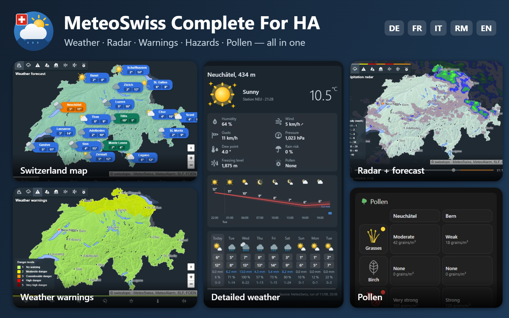

## Tout en un

| | |
|---|---|
| 🌤️ **Météo** | Conditions actuelles de la station la plus proche, prévisions sur 9 jours et heure par heure |
| 🌧️ **Radar** | Les 3 dernières heures du radar MétéoSuisse, puis la prévision de pluie des 12 heures suivantes |
| ⚠️ **Alertes intempéries** | Pluie, orages, vent, neige, routes glissantes, canicule, gel — alertes officielles de MétéoSuisse |
| 🔥 **Dangers naturels** | Incendies de forêt, crues, sécheresse (OFEV) et avalanches (SLF) |
| 🌼 **Pollen** | 7 espèces, 15 stations de mesure en Suisse |
| 🗺️ **Carte de la Suisse** | Tout cela sur une carte, ou zoomé sur votre région |

## Cinq langues

Tout — réglages, entités, cartes et carte de la Suisse — existe en **Deutsch, Français, Italiano, Rumantsch et English**. Les cartes suivent la langue de Home Assistant ; chaque carte peut aussi être réglée sur une autre langue.

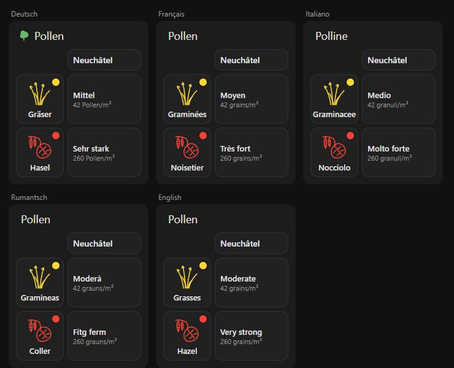

## Animé ou fixe, au choix

Trois packs de pictogrammes, un par symbole météo MétéoSuisse ; le pack animé est celui par défaut (réglages → Affichage).

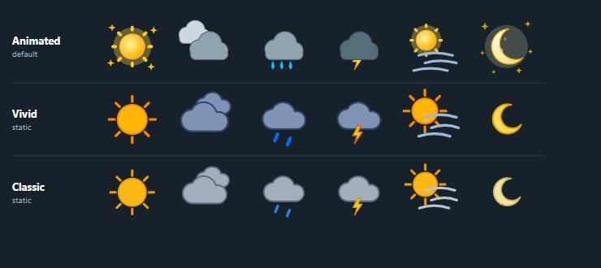

> Exemples : Neuchâtel et Berne ; certaines valeurs (prévisions, pollen) sont des exemples.

## Sommaire

1. [Installation](#1-installation)
2. [Réglages](#2-réglages)
3. [Carte Prévisions avec les pictogrammes animés](#3-carte-prévisions)
4. [Carte de la Suisse](#4-carte-de-la-suisse)
5. [Une carte par danger, ou zoomée sur votre région](#5-une-carte-par-danger-ou-zoomée-sur-votre-région)
6. [Sur téléphone](#6-sur-téléphone)
7. [Entités pour vos automatisations](#7-entités-pour-vos-automatisations)
8. [Mises à jour et versions](#8-mises-à-jour-et-versions)
9. [En cas de problème](#9-en-cas-de-problème)

---

## 1. Installation

Il faut Home Assistant **2026.1** ou plus récent, et [HACS](https://hacs.xyz).

1. Dans HACS, menu **⋮ → Dépôts personnalisés**.
2. Ajoutez `https://github.com/SashConnection/meteoswiss4HA`, catégorie **Intégration**.
3. Cherchez **MeteoSwiss Complete For HA**, cliquez **Télécharger**, puis **redémarrez Home Assistant**.
4. **Paramètres → Appareils et services → Ajouter une intégration**, cherchez **MeteoSwiss Complete For HA**.
5. Choisissez :
   - la **station de mesure** (la liste est triée de la plus proche à la plus éloignée de votre domicile) : elle donne la température, le vent, etc. actuels ;
   - le **numéro postal** utilisé pour les prévisions locales.

L'intégration crée une entité météo, des capteurs, et ajoute deux cartes pour les tableaux de bord.

## 2. Réglages

**Paramètres → Appareils et services → MeteoSwiss Complete For HA → Configurer**. Le menu propose trois pages :

| Page | Réglages |
|---|---|
| **Affichage** | Pack de pictogrammes : **Animé** (par défaut), **Vif** ou **Classique**. Option **« Afficher la page carte dans la barre latérale »** (désactivée par défaut). |
| **Prévisions** | Prévisions horaires oui/non, horizon (48 h par défaut) et fréquence de mise à jour. Les fichiers horaires de MétéoSuisse sont gros : réduisez l'horizon pour économiser de la bande passante. |
| **Pollen et dangers** | Station pollen et région d'avalanches. « Automatique » prend la plus proche du domicile. |

Après un changement, l'intégration se recharge toute seule.

## 3. Carte Prévisions

La carte météo standard de Home Assistant utilise toujours ses propres icônes. Pour voir **nos pictogrammes** (animés par défaut), utilisez la carte **MeteoSwiss forecast** :

**Modifier le tableau de bord → Ajouter une carte → cherchez « MeteoSwiss forecast »**.

| Heures et jours | Jours seulement, sans détails |
|---|---|
| 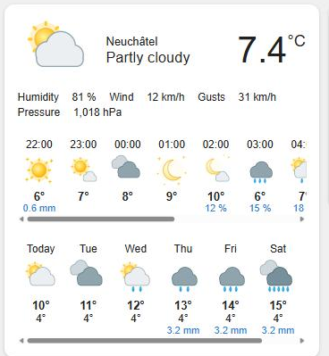 | 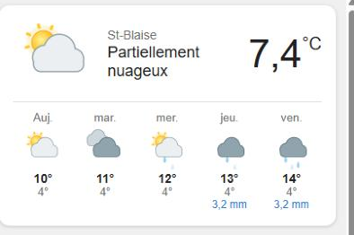 |

- **En haut** : météo actuelle (pictogramme, état du ciel, température mesurée) et détails (humidité, vent, rafales, pression). Un clic ouvre la fiche de l'entité.
- **Au milieu** : les prochaines heures (heure, pictogramme, température, pluie en mm ou probabilité en %). Faites défiler vers la droite.
- **En bas** : les prochains jours (minimum, maximum, pluie).

Réglages dans l'éditeur de la carte, ou en YAML :

```yaml
type: custom:meteoswiss-forecast-card
forecast: both        # both = heures et jours, daily, hourly ou none
days: 7               # 1 à 9
hours: 12
show_current: true    # météo actuelle
show_details: true    # humidité, vent, pression
```

Les prévisions par heure demandent l'option **Prévisions horaires** activée (page Prévisions des réglages).

### Carte météo détaillée

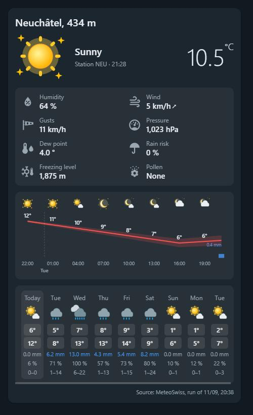

La carte **MeteoSwiss detailed weather** montre tout d’un coup :

- lieu et altitude, pictogramme, état du ciel, station de mesure et heure, température ;
- une grille de **mesures choisies une par une, dans l’ordre voulu** (cochez-les et glissez-les dans l’éditeur de la carte) ;
- un **graphique heure par heure** : pictogrammes, température avec sa bande d’incertitude 10–90 %, barres de pluie, séparation des jours ;
- **9 jours** : pictogramme, minimum et maximum, pluie, risque de pluie et fourchette de pluie (10–90 %) ;
- l’heure de la prévision utilisée.

Mesures disponibles : humidité, vent (avec sa direction), rafales, pression, point de rosée, risque de pluie, isotherme 0 °C, pollen, pluie et soleil des 10 dernières minutes, rayonnement, pression QNH, pression à la station, alertes.

```yaml
type: custom:meteoswiss-weather-card
details: [humidity, wind, gust, pressure, dew_point, precipitation_probability, freezing_level, pollen]
show_header: true
show_chart: true
hours: 24             # 6 à 48
show_daily: true
days: 9
```

<br clear="right">

### Carte pollen

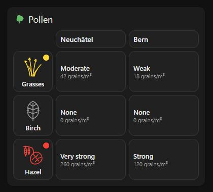

La carte **MeteoSwiss pollen** montre, pour chaque espèce choisie, une **esquisse de la plante** qui prend la couleur du niveau de pollen dès qu’il y en a, et pour chaque station choisie le **niveau et la concentration** (moyenne sur 24 heures ou dernière heure). Disposition : **tableau** (stations en colonnes) ou **liste**. Langues : de, fr, it, rm, en.

```yaml
type: custom:meteoswiss-pollen-card
stations: [PNE, PBE]  # Neuchâtel, Berne (par défaut : la station de l’intégration)
species: [grasses, birch, hazel]
layout: table         # ou list
value: mean           # ou latest
language: auto        # ou de, fr, it, rm, en
```

<br clear="right">

## 4. Carte de la Suisse

Ajoutez la carte **MeteoSwiss map** à un tableau de bord (ou activez la page dans la barre latérale, voir [Réglages](#2-réglages)). La barre de boutons en haut à gauche change de carte ; le **trait de couleur** au-dessus de chaque bouton donne le niveau de danger le plus élevé en ce moment en Suisse.

Boutons sous le zoom : **⌖** recentre la carte, **+ / −** zooment.

### Météo

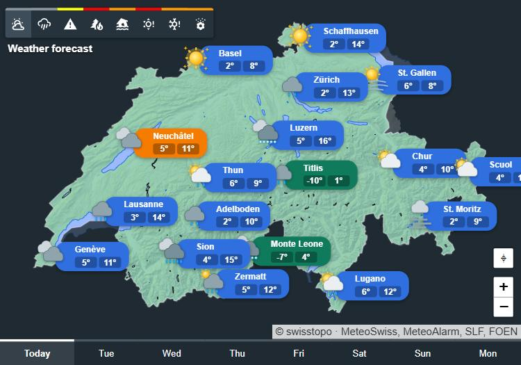

Pictogramme, minimum et maximum pour 31 villes et quelques sommets (en vert) ; votre domicile est en orange. Les onglets du bas choisissent le jour. En zoomant, d'autres lieux apparaissent.

### Radar des précipitations

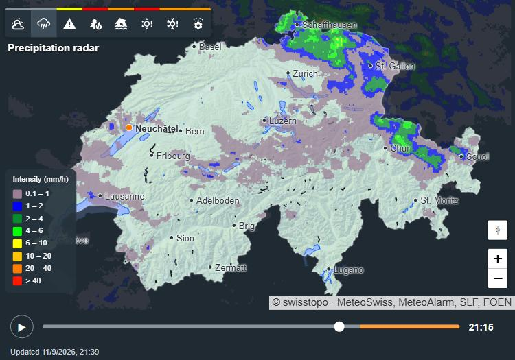

Les **3 dernières heures** du radar MétéoSuisse, une image toutes les 5 minutes, puis la **prévision de pluie heure par heure** (partie **orange** du curseur, libellé « Prévision ») :

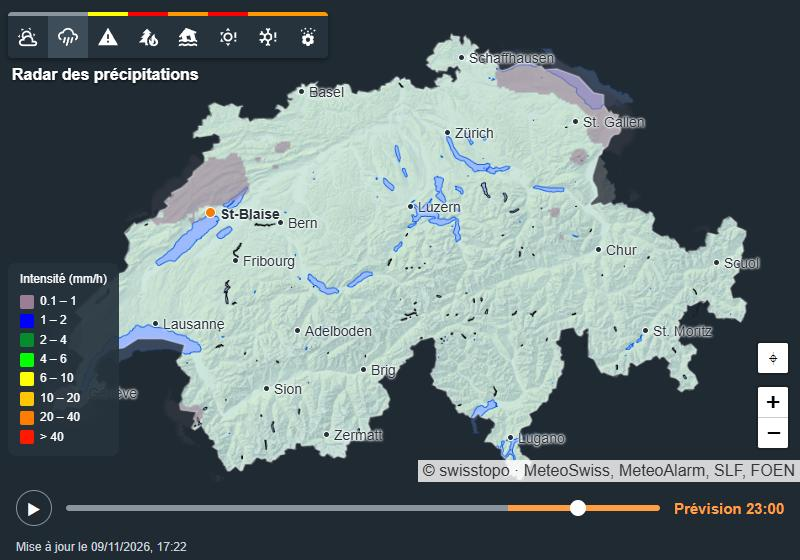

Le bouton ▶ / ❚❚ lance ou arrête l'animation ; le curseur permet de choisir une heure. Les images radar et la prévision de pluie sont préparées à partir des données MétéoSuisse par un serveur du projet (`ha.jesaispas.ch`), d’où Home Assistant les télécharge. Si ce serveur ne répond pas, la carte affiche « Le radar n'est pas disponible pour le moment ».

### Alertes intempéries

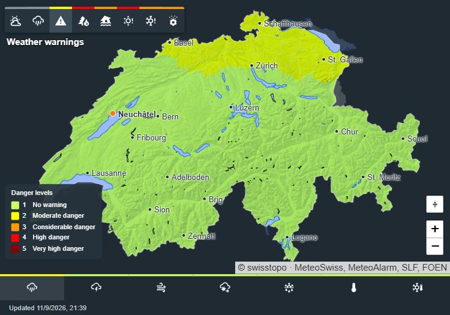

Les alertes officielles de MétéoSuisse : **pluie, orages, vent, neige, routes glissantes, canicule, gel** (onglets du bas). La Suisse est en vert quand il n'y a pas d'alerte ; les régions en alerte prennent la couleur du degré de danger. Les alertes **à venir** sont en pointillés. Passez la souris (ou touchez) une région pour voir le texte, le début et la fin de l'alerte.

### Incendies de forêt, crues, sécheresse

| Incendies | Crues | Sécheresse |
|---|---|---|
| 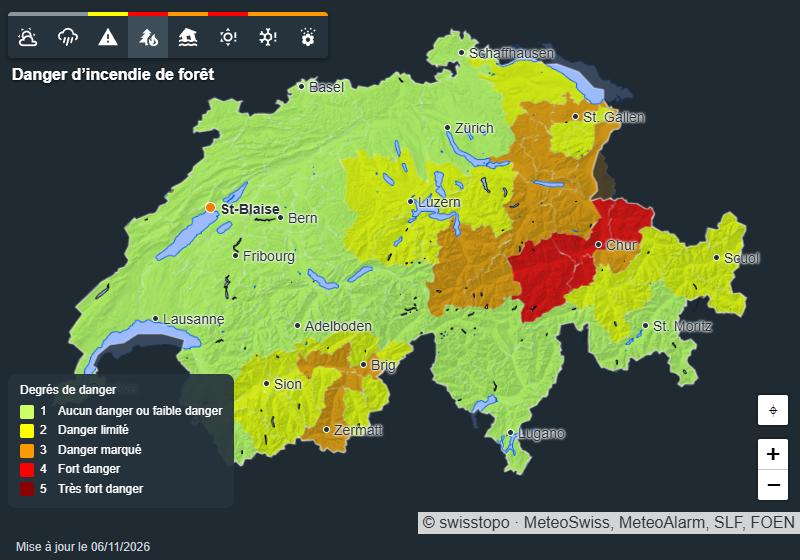 | 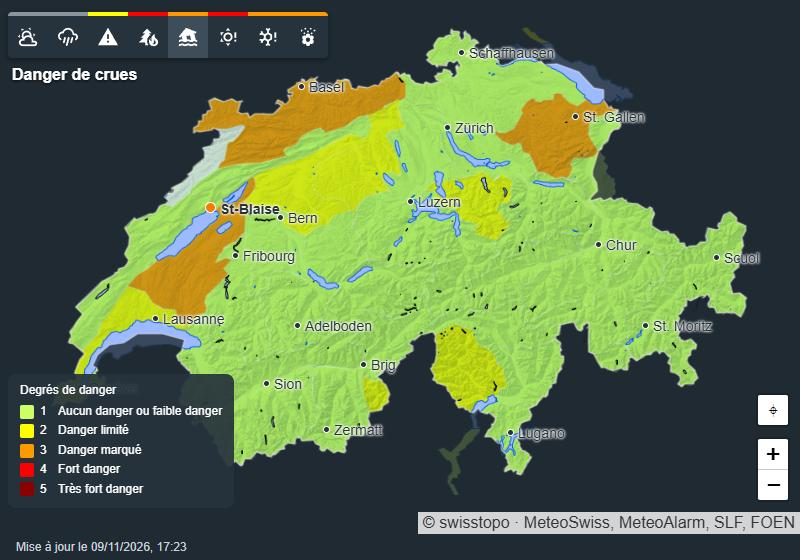 | 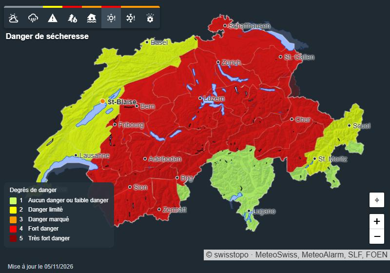 |

Cartes de l'OFEV par région (et par cours d'eau pour les crues). Les couches **Avalanches** (bulletin du SLF, en saison) et **Pollen** (15 stations de mesure) fonctionnent de la même façon.

### Degrés de danger

| Degré | Couleur | Signification |
|---|---|---|
| 1 | vert | Aucun danger ou danger faible (pas d'alerte) |
| 2 | jaune | Danger limité |
| 3 | orange | Danger marqué |
| 4 | rouge | Fort danger |
| 5 | rouge foncé | Très fort danger |

## 5. Une carte par danger, ou zoomée sur votre région

Dans l'éditeur de la carte **MeteoSwiss map** :

- **Couches affichées** : cochez **un seul** danger pour une carte dédiée, sans barre de boutons (vous pouvez en mettre plusieurs sur un tableau de bord) ;
- **Zone** : **Toute la Suisse** ou **Ma région (domicile)**, avec un niveau de **zoom** de 7 à 12 ;
- **Légende** affichée ou non, **hauteur** de la carte.

| Incendies seulement | Radar zoomé sur le domicile |
|---|---|
| 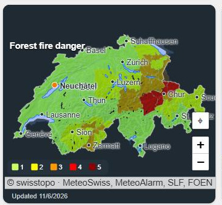 | 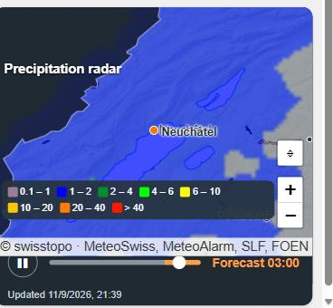 |

En YAML :

```yaml
type: custom:meteoswiss-map-card
layers: [radar]       # une ou plusieurs couches : weather, radar, warnings, fire, flood, drought, avalanche, pollen
area: home            # switzerland (par défaut) ou home
zoom: 9
legend: true
height: 360
```

## 6. Sur téléphone

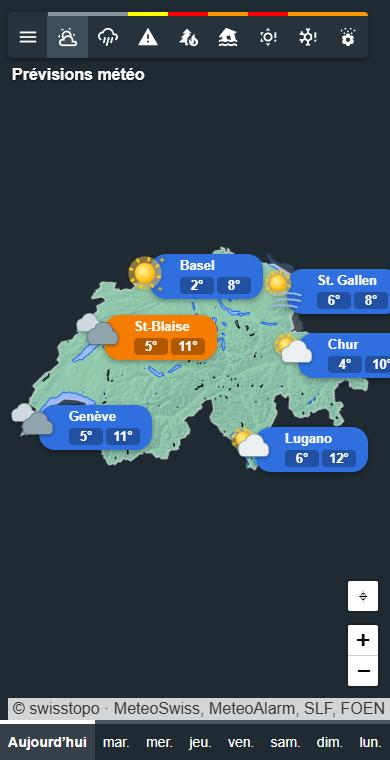

Sur un écran étroit, la légende devient une ligne compacte et les onglets utilisent des icônes. Dans la page de la barre latérale, le bouton ☰ ouvre le menu de Home Assistant.

## 7. Entités pour vos automatisations

| Entité | Contenu |
|---|---|
| `weather.<lieu>` | Météo actuelle et prévisions par jour et par heure (attribut `meteoswiss_symbol` en plus de l'état standard). |
| `sensor.<lieu>_temperature`, `_humidity`, … | Mesures de la station. |
| `sensor.<lieu>_meteoswiss_symbol`, `_weather_description` | Symbole et description officielle MétéoSuisse ; l'image du capteur est le pictogramme du pack choisi. |
| `sensor.<lieu>_rain_warning`, `_thunderstorm_warning`, `_wind_warning`, `_snow_warning`, `_slippery_roads_warning`, `_heat_warning`, `_frost_warning` | Alerte en cours chez vous (`low` = pas d'alerte). Attributs : texte, début, fin, et `upcoming` pour les alertes à venir. |
| `sensor.<lieu>_flood_danger`, `_forest_fire_danger`, `_drought_danger`, `_avalanche_danger` | Degré de danger de votre région. |
| `sensor.<lieu>_pollen_level`, `_birch_pollen`, … | Pollen : niveau général et concentration par espèce. |

Exemple : être averti dès qu'une alerte orage est annoncée.

```yaml
triggers:
  - trigger: state
    entity_id: sensor.maison_thunderstorm_warning
    attribute: upcoming
conditions:
  - condition: template
    value_template: "{{ state_attr('sensor.maison_thunderstorm_warning', 'upcoming') | count > 0 }}"
actions:
  - action: notify.notify
    data:
      message: "Alerte orages annoncée : {{ state_attr('sensor.maison_thunderstorm_warning', 'upcoming')[0].event }}"
```

## 8. Mises à jour et versions

Les versions suivent le calendrier : **ANNÉE.MOIS.N**, par exemple 2026.11.0, puis 2026.11.1 pour la mise à jour suivante du même mois, 2026.12.0 le mois suivant. Les nouveautés de chaque version sont dans le [CHANGELOG](../CHANGELOG.md).

Pour mettre à jour : HACS propose la nouvelle version → **Télécharger** → **redémarrer Home Assistant** → dans le navigateur, **Ctrl+F5** pour recharger les cartes.

## 9. En cas de problème

| Problème | Solution |
|---|---|
| Les cartes n'ont pas changé après une mise à jour | Ctrl+F5 dans le navigateur ; sur l'application mobile, *Paramètres de l'application → Débogage → Recharger le frontend*. |
| La carte est décentrée | Bouton **⌖** sous le zoom. |
| « Le radar n'est pas disponible pour le moment » | Le serveur radar du projet ne répond pas ; il se rétablit tout seul, réessayez plus tard. |
| Pas de prévisions par heure | Activez **Prévisions horaires** dans les réglages (page Prévisions). |
| Une alerte ou un danger est « indisponible » | La source (MétéoSuisse/MeteoAlarm, OFEV, SLF) ne répond pas ; la valeur revient à la mise à jour suivante. |

Sources : MétéoSuisse (Open Data, CC BY 4.0), alertes MétéoSuisse via MeteoAlarm, OFEV, SLF, fond de carte swisstopo. Ce projet n'est pas affilié à MétéoSuisse.
