# Mode d'emploi – MeteoSwiss Complete For HA


🇬🇧 **[English version](../README.md)**

**Toute la météo suisse dans Home Assistant, en une seule intégration.**
Données officielles de MétéoSuisse, cartes prêtes à l’emploi, rien à programmer — en **allemand, français, italien, romanche et anglais**.

## Prêt à l’emploi — sans une ligne de YAML

**On installe, on choisit sa station, on ajoute un panneau : c’est tout.** Chaque panneau se règle en quelques clics dans l’éditeur visuel : des sections claires avec un résumé de ce qui est activé, un bouton ↺ pour revenir aux réglages d’origine et un lien vers la bonne page de ce mode d’emploi. Pas de code, pas de YAML, pas de modèle à recopier — et tout parle la langue de votre Home Assistant.

<table><tr>
<td width="38%" valign="top">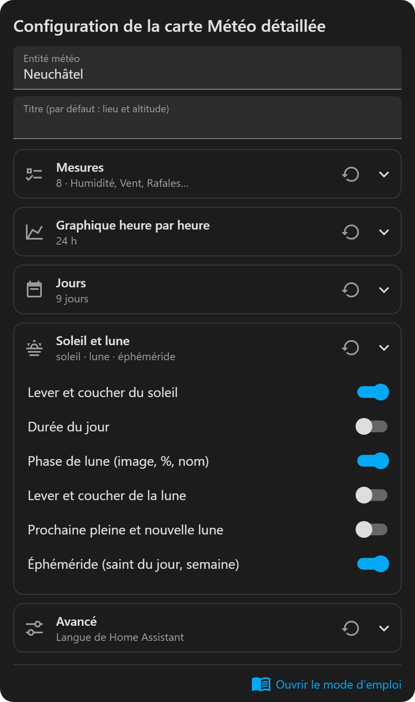</td>
<td valign="top">

- ✅ **Ça marche tout de suite** : la station, le point de prévision, la station pollen et la région d’avalanches sont trouvés pour votre domicile.
- 🖱️ **Tout dans l’éditeur** : cochez les mesures voulues, glissez-les dans l’ordre, activez le graphique, les jours, le soleil et la lune d’un clic.
- 🔔 **Automatisations par menus** : *La pluie arrive bientôt*, *Premier gel*, *Le brouillard se dissipe*, *Alerte orages annoncée*… on choisit un déclencheur, sans YAML.
- 🌍 **5 langues** qui suivent Home Assistant toutes seules (allemand, français, italien, romanche, anglais).
- 🎨 **Beau partout** : téléphone, tablette, écran mural, thème clair ou sombre.

</td></tr></table>

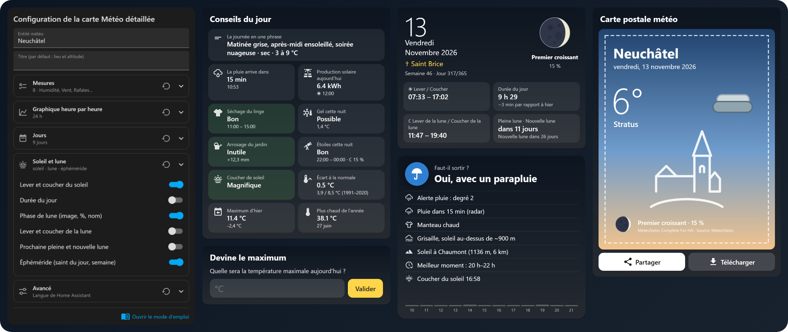

<sub>Valeurs d’exemple.</sub>

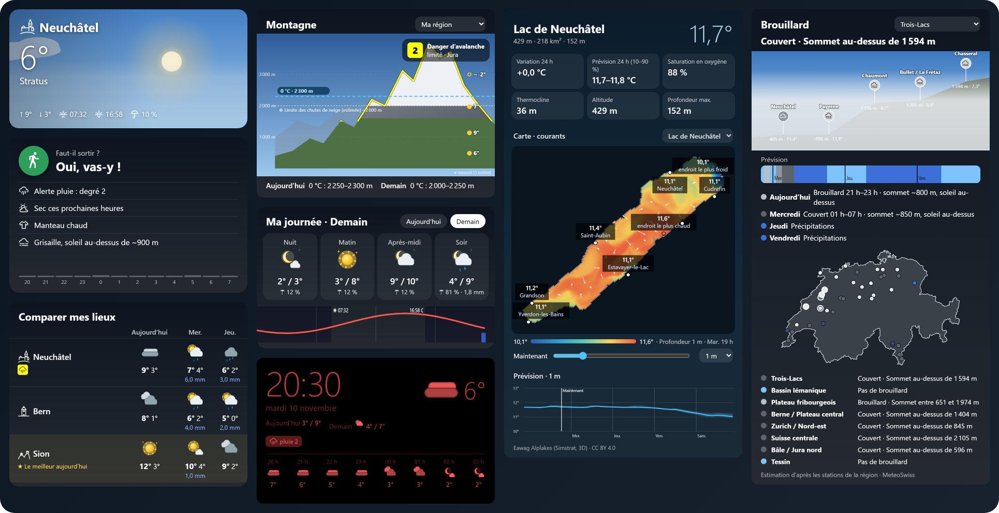


## Tout en un

| | |
|---|---|
| 🌤️ **Météo** | Conditions actuelles de la station la plus proche, prévisions sur 9 jours et heure par heure |
| 🌧️ **Radar** | Les 3 dernières heures du radar MétéoSuisse, puis la prévision de pluie des 12 heures suivantes |
| ⚠️ **Alertes intempéries** | Pluie, orages, vent, neige, routes glissantes, canicule, gel — alertes officielles de MétéoSuisse |
| 🔥 **Dangers naturels** | Incendies de forêt, crues, sécheresse (OFEV) et avalanches (SLF) |
| 🌼 **Pollen** | 7 espèces, 15 stations de mesure en Suisse |
| 🗺️ **Carte de la Suisse** | Tout cela sur une carte, ou zoomé sur votre région |
| 📍 **Vos lieux** | Alertes pour d’autres lieux (p. ex. Berne, Cernier) et **là où vous êtes** (suit votre téléphone), avec des déclencheurs d’automatisation prêts à l’emploi ; comparez-les côte à côte |
| 🌫️ **Brouillard par région** | Mer de brouillard détectée avec des stations repères de la plaine aux sommets (Neuchâtel → Chaumont → Chasseral), sommet estimé et prévision sur 3 jours, déclencheurs « le brouillard se forme / se dissipe » |
| 🏞️ **Lacs** | 27 lacs suisses : température de l’eau avec prévision sur 4 jours, oxygène, thermocline, glace, profil ; 13 lacs dessinés en couleur avec leurs courants (Eawag) |
| 🏔️ **Montagne** | Isotherme 0 °C, limite de la neige, températures par altitude, mer de brouillard et danger d’avalanche — votre région, une grande région ou toute la Suisse |
| 🧥 **Au quotidien** | *Faut-il sortir ?*, *Ma journée*, un ciel animé en direct et un écran mural avec mode nuit rouge sombre |
| 🌧️ **La pluie dans 20 minutes** | Le radar dit quand la pluie arrive chez vous, avec un déclencheur prêt à l’emploi |
| 💡 **Conseils du jour** | Séchage du linge, gel cette nuit, arrosage, étoiles, coucher de soleil, arc-en-ciel, foehn, bise, aérer — et la journée en une phrase |
| ☀️ **Prévision solaire** | La production de vos panneaux aujourd’hui et demain, heure par heure (il suffit d’entrer leur puissance) |
| 🌙 **Soleil, lune, éphéméride** | Lever, coucher, durée du jour, phase de lune dessinée au jour près (%, nom), saint du jour — dans les panneaux de votre choix |
| 📈 **Historique** | Hier, la normale 1991–2020, les records de l’année, le premier gel et la première neige de la saison |
| 🎁 **Pour le plaisir** | Une carte postale météo à partager, un jeu « devine le maximum », un badge pour le haut du tableau de bord, une couleur pour vos lampes |

## Les nouveaux panneaux en un coup d’œil

| | |
|---|---|
| 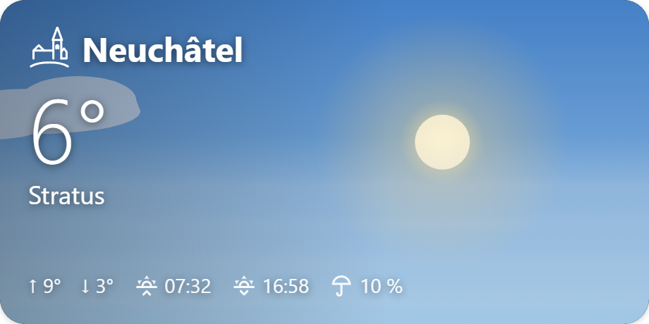<br>**Ciel en direct** — le ciel du moment dessiné et animé : soleil ou lune, nuages poussés par le vent, pluie, neige, brouillard, étoiles | 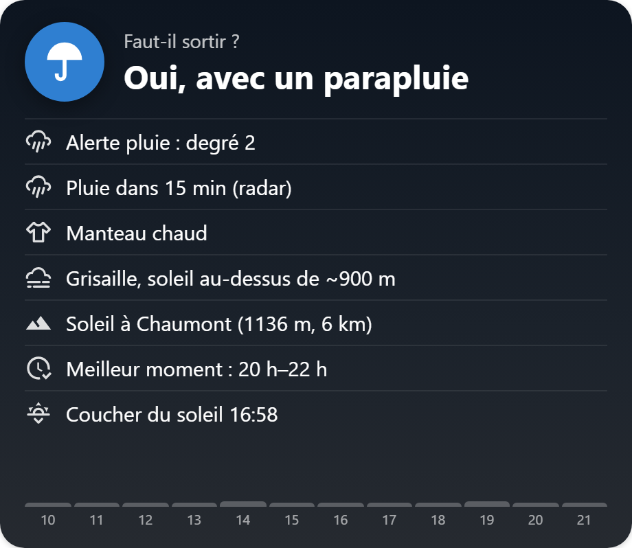<br>**Faut-il sortir ?** — un verdict clair, l’heure de la pluie, quoi mettre, rafales, alertes, pollen, brouillard, meilleur moment |
| 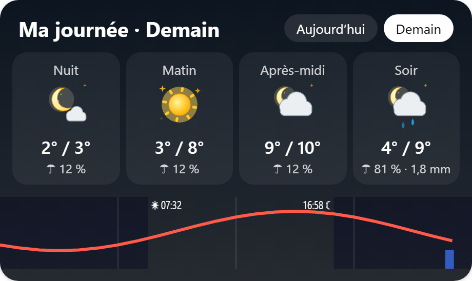<br>**Ma journée** — nuit, matin, après-midi, soir, avec la courbe de température, le lever et le coucher du soleil | 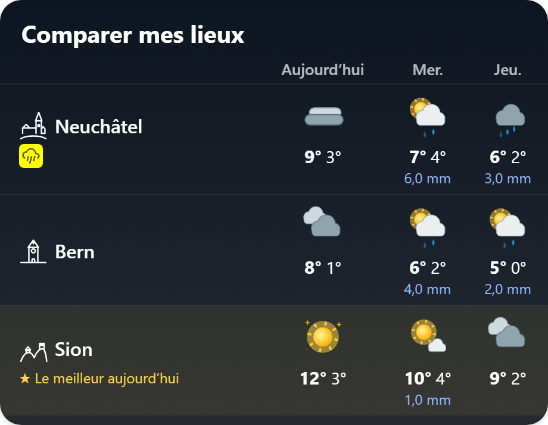<br>**Comparer mes lieux** — chez vous et vos lieux surveillés (p. ex. Berne) côte à côte, avec le meilleur endroit du jour |
| 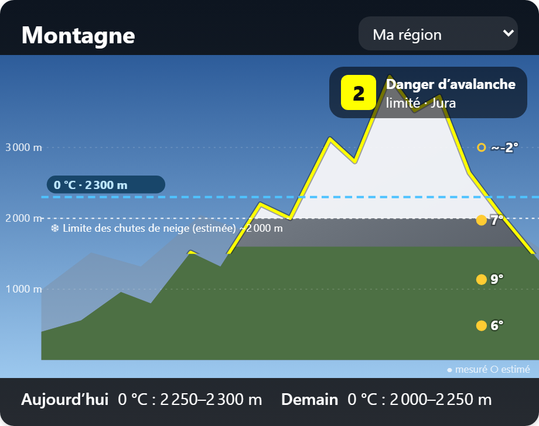<br>**Montagne** — isotherme 0 °C, limite de la neige, températures par altitude, mer de brouillard, danger d’avalanche | 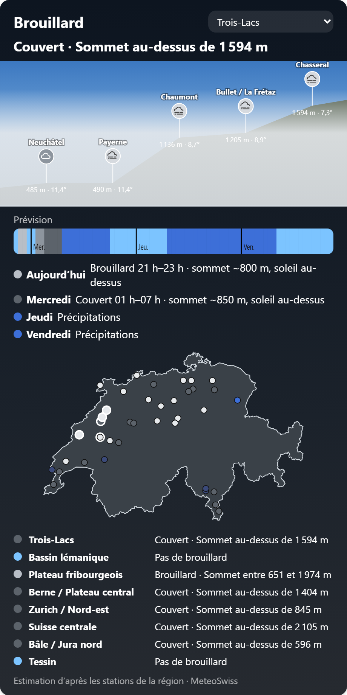<br>**Brouillard par région** — stations repères de la plaine aux sommets (Neuchâtel, Chaumont, Chasseral…), sommet du brouillard, prévision sur 3 jours |
| 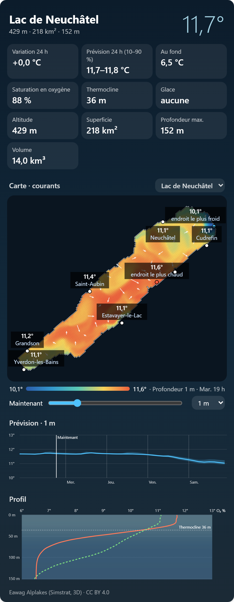<br>**Lacs** — 27 lacs : température de l’eau et prévision, oxygène, thermocline, glace, profil ; 13 lacs dessinés en couleur avec les courants | 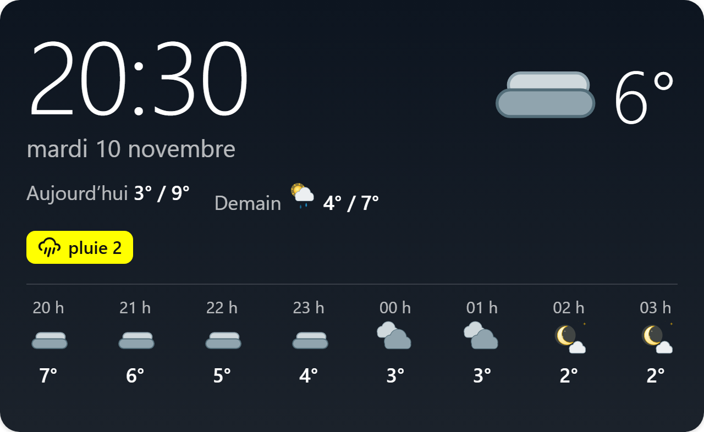<br>**Écran mural** — grande horloge, météo, prochaines heures, alertes<br><br>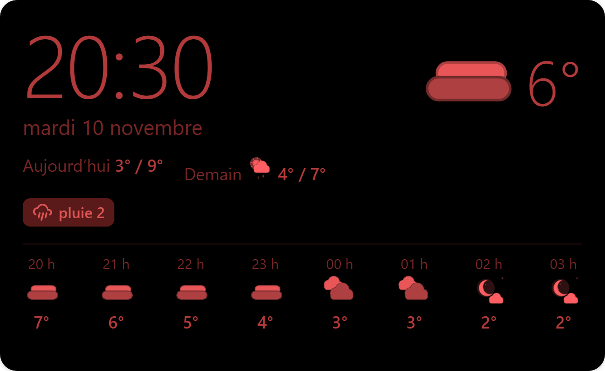<br>**… et son mode nuit** rouge sombre, qui n’éclaire pas la pièce |

<sub>Lac et brouillard : données réelles du 10 novembre 2026 (Eawag Alplakes, stations MétéoSuisse). Les autres valeurs sont des exemples.</sub>


## Un monument pour chaque ville

Chaque ville de la carte a son pictogramme dessiné de son monument le plus connu : la Zytglogge à Berne, le Jet d’eau à Genève, la Kapellbrücke à Lucerne, le château et la Collégiale à Neuchâtel, le Cervin à Zermatt… Ils apparaissent sur les étiquettes de la carte et à côté du nom du lieu dans les panneaux (option `monument: false` pour les masquer).

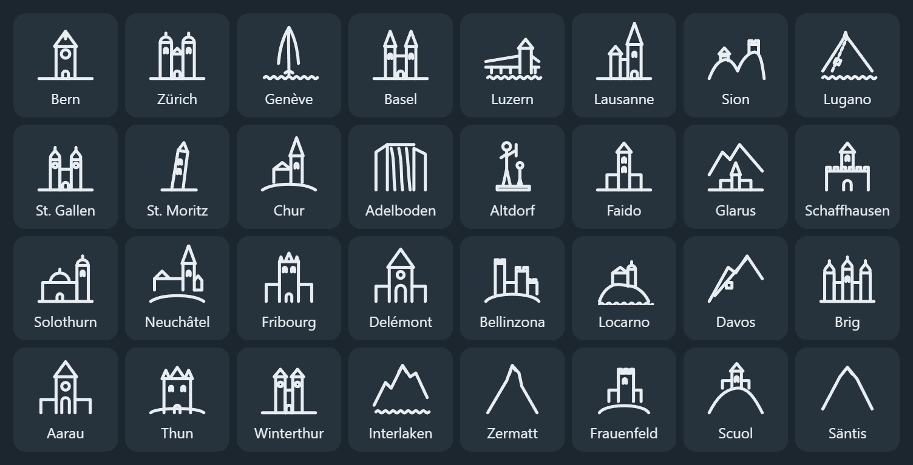

## Cinq langues

Tout — réglages, entités, cartes et carte de la Suisse — existe en **Deutsch, Français, Italiano, Rumantsch et English**. Les cartes suivent la langue de Home Assistant ; chaque carte peut aussi être réglée sur une autre langue.


## Animé ou fixe, au choix

Trois packs de pictogrammes, un par symbole météo MétéoSuisse ; le pack animé est celui par défaut (réglages → Affichage).


> Exemples : Neuchâtel et Berne ; les panneaux lac et brouillard montrent des données réelles du 10 novembre 2026, certaines autres valeurs (prévisions, pollen) sont des exemples.

## Sommaire

1. [Installation](#1-installation)
2. [Réglages](#2-réglages)
3. [Carte Prévisions avec les pictogrammes animés](#3-carte-prévisions) · [Conseils du jour](#conseils-du-jour) · [Soleil, lune et éphéméride](#soleil-lune-et-éphéméride) · [Panneaux du quotidien](#panneaux-du-quotidien) · [Montagne](#montagne) · [Brouillard par région](#brouillard-par-région) · [Lacs](#lacs)
4. [Carte de la Suisse](#4-carte-de-la-suisse)
5. [Une carte par danger, ou zoomée sur votre région](#5-une-carte-par-danger-ou-zoomée-sur-votre-région)
6. [Sur téléphone](#6-sur-téléphone)
7. [Entités pour vos automatisations](#7-entités-pour-vos-automatisations)
8. [Mises à jour et versions](#8-mises-à-jour-et-versions)
9. [En cas de problème](#9-en-cas-de-problème)

---

## 1. Installation

Il faut Home Assistant **2026.1** ou plus récent, et [HACS](https://hacs.xyz).

1. Dans HACS, menu **⋮ → Dépôts personnalisés**.
2. Ajoutez `https://github.com/SashConnection/meteoswiss4HA`, catégorie **Intégration**.
3. Cherchez **MeteoSwiss Complete For HA**, cliquez **Télécharger**, puis **redémarrez Home Assistant**.
4. **Paramètres → Appareils et services → Ajouter une intégration**, cherchez **MeteoSwiss Complete For HA**.
5. Choisissez :
   - la **station de mesure** (la liste est triée de la plus proche à la plus éloignée de votre domicile) : elle donne la température, le vent, etc. actuels ;
   - le **numéro postal** utilisé pour les prévisions locales.

L'intégration crée une entité météo, des capteurs, et ajoute deux cartes pour les tableaux de bord.

## 2. Réglages

**Paramètres → Appareils et services → MeteoSwiss Complete For HA → Configurer**. Le menu propose six pages :

| Page | Réglages |
|---|---|
| **Affichage** | Pack de pictogrammes : **Animé** (par défaut), **Vif** ou **Classique**. Option **« Afficher la page carte dans la barre latérale »** (désactivée par défaut). |
| **Prévisions** | Prévisions horaires oui/non, horizon (48 h par défaut) et fréquence de mise à jour. Les fichiers horaires de MétéoSuisse sont gros : réduisez l'horizon pour économiser de la bande passante. |
| **Pollen et dangers** | Station pollen et région d'avalanches. « Automatique » prend la plus proche du domicile. |
| **Lacs et brouillard** | Les lacs qui ont un capteur de température de l’eau (par défaut : le lac le plus proche du domicile, s’il est à moins de 15 km) et le **brouillard par région** (activé par défaut). |
| **Alerte pluie, solaire et intérieur** | Alerte pluie d’après le radar (et combien de minutes à l’avance), vos panneaux solaires (puissance, inclinaison, orientation) et vos capteurs intérieurs (aérer). |
| **Lieux et personnes surveillés** | Numéros postaux ou lieux, et personnes à suivre (voir plus bas). |

Après un changement, l'intégration se recharge toute seule.

## 3. Carte Prévisions

La carte météo standard de Home Assistant utilise toujours ses propres icônes. Pour voir **nos pictogrammes** (animés par défaut), utilisez la carte **MeteoSwiss forecast** :

**Modifier le tableau de bord → Ajouter une carte → cherchez « MeteoSwiss forecast »**.

| Heures et jours | Jours seulement, sans détails |
|---|---|
|  |  |

- **En haut** : météo actuelle (pictogramme, état du ciel, température mesurée) et détails (humidité, vent, rafales, pression). Un clic ouvre la fiche de l'entité.
- **Au milieu** : les prochaines heures (heure, pictogramme, température, pluie en mm ou probabilité en %). Faites défiler vers la droite.
- **En bas** : les prochains jours (minimum, maximum, pluie).

Réglages dans l'éditeur de la carte, ou en YAML :

```yaml
type: custom:meteoswiss-forecast-card
forecast: both        # both = heures et jours, daily, hourly ou none
days: 7               # 1 à 9
hours: 12
show_current: true    # météo actuelle
show_details: true    # humidité, vent, pression
```

Les prévisions par heure demandent l'option **Prévisions horaires** activée (page Prévisions des réglages).

### Carte météo détaillée


La carte **MeteoSwiss detailed weather** montre tout d’un coup :

- lieu et altitude, pictogramme, état du ciel, station de mesure et heure, température ;
- une grille de **mesures choisies une par une, dans l’ordre voulu** (cochez-les et glissez-les dans l’éditeur de la carte) ;
- un **graphique heure par heure** : pictogrammes, température avec sa bande d’incertitude 10–90 %, barres de pluie, séparation des jours ;
- **9 jours** : pictogramme, minimum et maximum, pluie, risque de pluie et fourchette de pluie (10–90 %) ;
- l’heure de la prévision utilisée.

Mesures disponibles : humidité, vent (avec sa direction), rafales, pression, point de rosée, risque de pluie, isotherme 0 °C, pollen, pluie et soleil des 10 dernières minutes, rayonnement, pression QNH, pression à la station, alertes.

```yaml
type: custom:meteoswiss-weather-card
details: [humidity, wind, gust, pressure, dew_point, precipitation_probability, freezing_level, pollen]
show_header: true
show_chart: true
hours: 24             # 6 à 48
show_daily: true
days: 9
```

<br clear="right">

### Carte pollen


La carte **MeteoSwiss pollen** montre, pour chaque espèce choisie, une **esquisse de la plante** qui prend la couleur du niveau de pollen dès qu’il y en a, et pour chaque station choisie le **niveau et la concentration** (moyenne sur 24 heures ou dernière heure). Disposition : **tableau** (stations en colonnes) ou **liste**. Langues : de, fr, it, rm, en.

```yaml
type: custom:meteoswiss-pollen-card
stations: [PNE, PBE]  # Neuchâtel, Berne (par défaut : la station de l’intégration)
species: [grasses, birch, hazel]
layout: table         # ou list
value: mean           # ou latest
language: auto        # ou de, fr, it, rm, en
```

<br clear="right">

### Panneaux « Maintenant », « Jours » et « Tuiles »

| Maintenant | Jours | Tuiles |
|---|---|---|
| 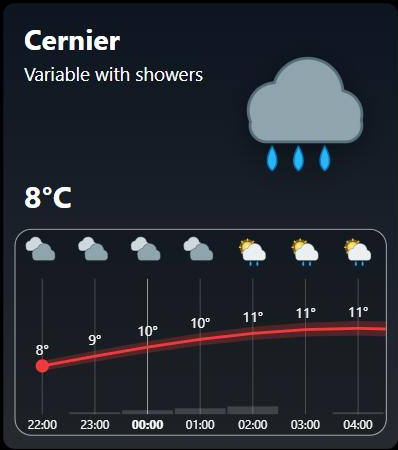 | 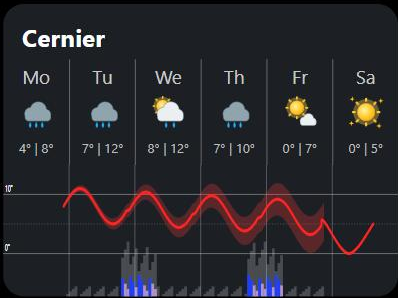 | 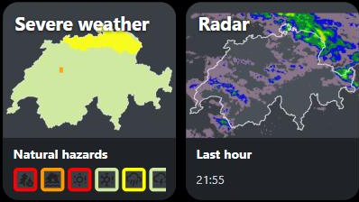 |

- **MeteoSwiss now** : grand pictogramme, lieu, état du ciel et température, puis les prochaines heures (température avec sa bande d’incertitude, probabilité et quantité de pluie).
- **MeteoSwiss days** : les jours (pictogramme, min | max) au-dessus d’une courbe de température continue et de la pluie. La courbe utilise les prévisions horaires (48 h par défaut), puis passe par les minimum et maximum du jour ; réglez l’horizon horaire sur 120 h pour une courbe complète.
- **MeteoSwiss tiles** : mini-carte des intempéries avec les pastilles des dangers, et radar animé de la dernière heure. Un toucher ouvre la page choisie (p. ex. `/meteoswiss`).

### Alertes pour vos lieux et là où vous êtes

**Paramètres → Appareils et services → MeteoSwiss Complete For HA → Configurer → Lieux et personnes surveillés** :

- **Numéros postaux ou lieux** : p. ex. `2053` ou `Cernier`, `3000` ou `Berne` (le point de prévision le plus proche est utilisé) ;
- **Personnes à suivre** : une personne ou le suivi de votre téléphone (application Home Assistant). Les alertes suivent sa position (en Suisse).

Chacun devient un appareil (p. ex. *MeteoSwiss Bern (3004)*) avec les 7 capteurs d’alertes.

**Déclencheurs prêts à l’emploi** : Paramètres → Automatisations → Créer → Ajouter un déclencheur → **Appareil** → un appareil MeteoSwiss, puis p. ex. *Alerte orages annoncée*, *Alerte pluie en vigueur* / *Fin de l’alerte pluie*, *L’alerte vent atteint un degré* (2 à 5) ; sur l’appareil principal aussi les dangers (incendie, crues, sécheresse, avalanches), le pollen, *Le brouillard ou le stratus se forme* et *Le brouillard se dissipe*. Aucun YAML nécessaire.

### Conseils du jour

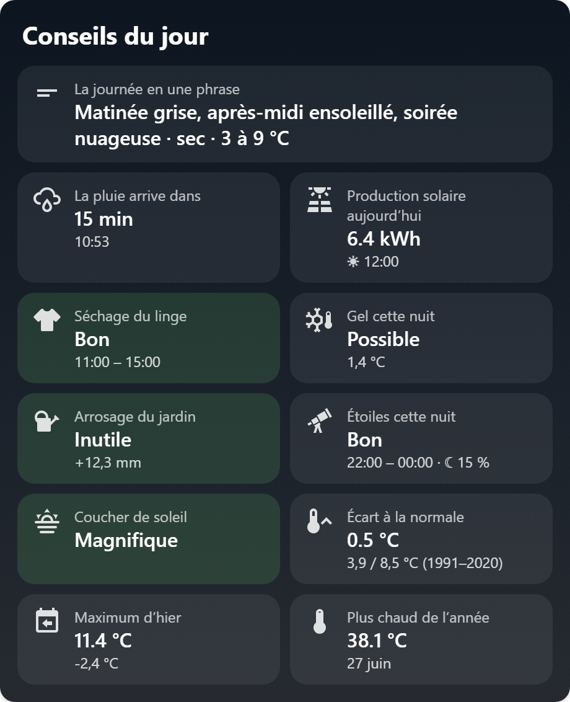

Un seul panneau, les tuiles que vous choisissez : **la journée en une phrase**, **la pluie dans … minutes** (radar), la **production solaire** aujourd’hui et demain, le **séchage du linge** (meilleur moment), le **gel cette nuit** (plantes et pare-brise), l’**arrosage du jardin** (bilan d’eau des 5 derniers jours), les **étoiles cette nuit** (nuages et lune), le **coucher de soleil** (coloré ou terne), l’**arc-en-ciel** (possible maintenant), le **foehn**, la **bise**, **aérer** (humidité dedans / dehors), l’**écart à la normale 1991–2020**, **hier**, les **records de l’année**, le **premier gel** et la **première neige**. Les bonnes nouvelles sont en vert ; un toucher ouvre le détail.

Chaque conseil est aussi un capteur pour vos automatisations, et plusieurs ont un déclencheur prêt à l’emploi : *La pluie arrive bientôt*, *Premier gel de la saison*, *Première neige*, *Arc-en-ciel possible*, *Beau coucher de soleil prévu*, *Le foehn souffle*, *La bise souffle*.

<br clear="right">

### Soleil, lune et éphéméride

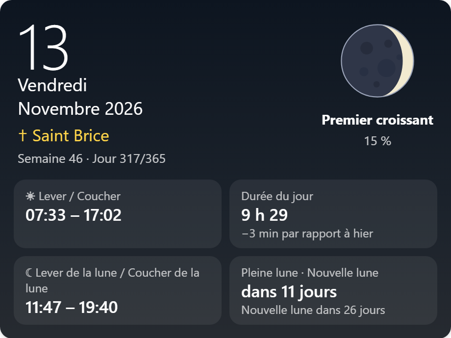

Dans l’éditeur des panneaux Météo détaillée, Prévisions, Maintenant, Jours, Ma journée, Ciel et Écran mural, la section **Soleil et lune** ajoute d’un clic : lever et coucher du soleil, durée du jour (et l’écart avec la veille), la **phase de lune dessinée pour le jour exact** avec son % et son nom, lever et coucher de la lune, prochaine pleine et nouvelle lune, et l’**éphéméride** (saint du jour, numéro de semaine et du jour) — dans la langue du panneau. Le panneau **Éphéméride** montre tout d’un coup.

Capteurs : *Phase de lune*, *Durée du jour*, *Saint du jour*.

<br clear="right">

### Pluie qui arrive, panneaux solaires, aérer

**Paramètres → Appareils et services → MeteoSwiss Complete For HA → Configurer → Alerte pluie, solaire et intérieur** :

- **Alerte pluie** : activée par défaut ; choisissez combien de minutes à l’avance (20 par défaut). Le capteur *La pluie arrive dans* donne les minutes, et le déclencheur *La pluie arrive bientôt* vous prévient à temps pour rentrer le linge.
- **Panneaux solaires** : entrez la puissance crête (kWc), l’inclinaison et l’orientation — les capteurs *Production solaire aujourd’hui / demain* donnent les kWh et la meilleure heure, heure par heure dans leurs attributs. Idéal pour lancer le lave-vaisselle ou recharger la voiture au bon moment.
- **Capteurs intérieurs** : choisissez vos capteurs de température et d’humidité ; *Aérer* dit quand ouvrir les fenêtres assèche la maison.

### Carte postale, devinette, badge, couleur d’ambiance, fond animé

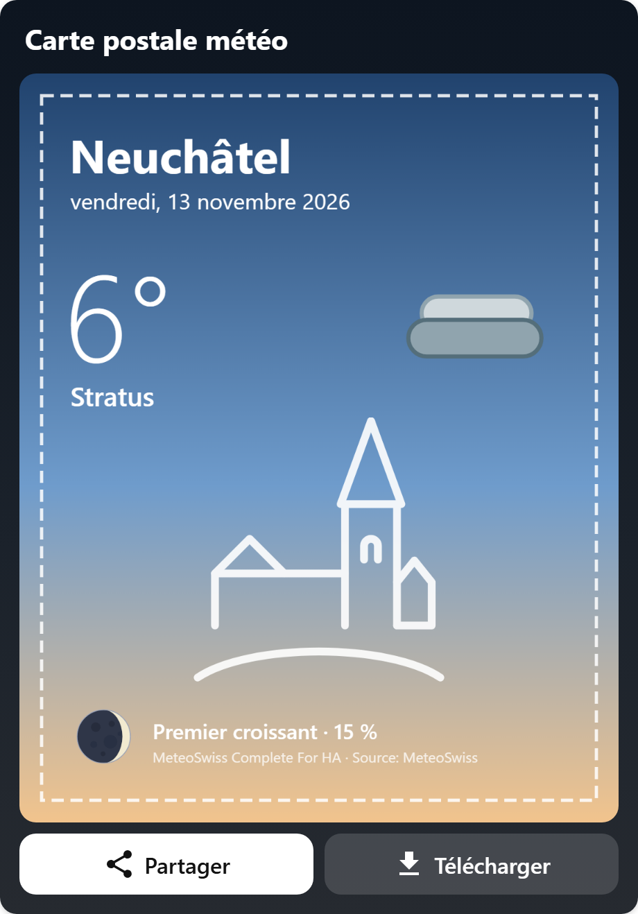

- **Carte postale météo** : le monument de votre ville, la météo du moment et la lune sur une carte postale — **Partager** (téléphone) ou **Télécharger**.
- **Devine le maximum** : pariez sur la température maximale du jour, découvrez le résultat mesuré le soir, gardez votre série.
- **Badge** : le pictogramme et la température en haut du tableau de bord, avec « ☂ Pluie dans 15 min » quand elle arrive.
- **Couleur d’ambiance** : le capteur donne une couleur selon la météo et l’heure (attribut `rgb_color`) pour une lampe connectée.
- **Fond animé** : le panneau Ciel avec l’option *En fond du tableau de bord* dessine le ciel animé derrière vos panneaux (avec un thème au fond de vue transparent).

<br clear="right">

### Panneaux du quotidien

- **Ciel en direct** (`meteoswiss-sky-card`) : le ciel du moment, animé, derrière le lieu et la température — soleil ou lune sur sa course entre le lever et le coucher, nuages qui avancent avec le vent, pluie, neige, éclairs, bancs de brouillard, étoiles. `animate: false` pour une image fixe (aussi quand l’appareil demande moins d’animations).
- **Faut-il sortir ?** (`meteoswiss-outing-card`) : un verdict (*Oui, vas-y !*, *avec un parapluie*, *plutôt plus tard*, *mieux vaut rester*) et les raisons : l’heure où la pluie commence, quoi mettre selon la température et le vent, rafales, alertes en vigueur, pollen, brouillard avec l’altitude du soleil, le meilleur créneau de 2 heures, le coucher du soleil. `hours: 12`.
- **Ma journée** (`meteoswiss-day-card`) : nuit, matin, après-midi et soir avec pictogramme, températures et pluie, au-dessus de la courbe de température avec le lever et le coucher du soleil. Boutons Aujourd’hui / Demain (demain d’abord après 18 h).
- **Comparer mes lieux** (`meteoswiss-compare-card`) : chez vous et chaque lieu surveillé, sur 1 à 5 jours, alertes en vigueur, et ★ le meilleur endroit du jour (le plus sec, puis le plus chaud). Ajoutez des lieux dans les options (*Lieux et personnes surveillés*).
- **Écran mural** (`meteoswiss-wall-card`) : grande horloge, date, température, aujourd’hui et demain, alertes et prochaines heures. `night_mode: auto` passe tout en rouge sombre après le coucher du soleil (`on` / `off` pour forcer).

```yaml
type: custom:meteoswiss-outing-card
hours: 12
---
type: custom:meteoswiss-wall-card
night_mode: auto        # auto (soleil), on, off
hours: 8
```

### Montagne


Une montagne générique (sans noms) jusqu’à 4000 m avec :

- l’**isotherme 0 °C** de la prévision locale, et sa fourchette aujourd’hui et demain ;
- la **limite des chutes de neige** quand des précipitations sont prévues (≈ 300 m sous le 0 °C, *estimée*) ;
- les **températures par altitude** : ● *mesurées* par une station proche de chez vous à cette altitude (p. ex. Chaumont, Chasseral, Moléson), ○ *estimées* entre votre température et le 0 °C là où il n’y a pas de station ;
- la **mer de brouillard** de votre région (voir plus bas) ;
- le **danger d’avalanche**, avec un menu : *ma région*, une grande région (*Jura, Préalpes, Alpes bernoises, Alpes valaisannes, Suisse centrale, Grisons nord, Engadine, Sud des Alpes*) ou *toute la Suisse* (degré le plus élevé).

```yaml
type: custom:meteoswiss-mountain-card
avalanche_scope: home    # home, switzerland, jura, prealps, bernese, valais, central, grisons, engadine, south
```

<br clear="right">

### Brouillard par région


MétéoSuisse ne publie pas de mesure du « sommet du brouillard » : l’intégration le **lit dans les stations**. Chaque région a une échelle de stations de la plaine aux sommets. Une station est *dans le brouillard* quand elle n’a pas de soleil et que l’air est saturé ; elle est *au-dessus* quand elle a du soleil (de jour) ou de l’air sec (de nuit). Le sommet est entre les deux.

| Région | Plaine | Collines et sommets |
|---|---|---|
| Trois-Lacs | Neuchâtel 485 m, Payerne 490 m | Chaumont 1136 m, La Frétaz 1205 m, Chasseral 1594 m |
| Bassin lémanique | Genève 411 m, Changins 458 m, Pully 456 m | Bière 684 m, La Dôle 1670 m |
| Plateau fribourgeois | Payerne 490 m, Grangeneuve 651 m | Plaffeien 1042 m, Moléson 1974 m |
| Berne / Plateau central | Wynau 422 m, Berne 553 m | Bantiger 942 m, Napf 1404 m |
| Zurich / Nord-est | Kloten 426 m, Tänikon 539 m, Zurich 604 m | Lägern 845 m, Uetliberg 854 m, Hörnli 1133 m, Säntis 2501 m |
| Suisse centrale | Lucerne 454 m, Mosen 453 m, Egolzwil 522 m | Einsiedeln 911 m, Pilate 2105 m |
| Bâle / Jura nord | Bâle 316 m, Delémont 439 m | Fahy 596 m, Rünenberg 611 m |
| Tessin | Magadino 203 m, Lugano 273 m, Locarno 367 m | Monte Generoso 1600 m, Cimetta 1661 m |

- **Maintenant** : toutes les 10 minutes, d’après les mesures (soleil, humidité, point de rosée, précipitations).
- **Prévision** : heure par heure sur 3 jours, d’après la prévision locale des mêmes stations (symboles *stratus* et *brouillard*, nébulosité basse, durée d’ensoleillement), résumée par jour : *mercredi : stratus 6–14 h, sommet ~1000 m, soleil au-dessus*.
- **Capteurs** : `sensor.<lieu>_fog` (pas de brouillard, brouillard, stratus, couvert, précipitations ; attributs : région, `top_min`, `top_max`, stations, prévision) et `sensor.<lieu>_fog_top` (sommet estimé, m).
- **Déclencheurs** : *Le brouillard ou le stratus se forme* / *Le brouillard se dissipe*.

```yaml
type: custom:meteoswiss-fog-card
region: three_lakes     # par défaut : votre région
show_forecast: true
show_map: true
show_all: false         # liste de toutes les régions
```

La prévision lit trois fichiers horaires de MétéoSuisse toutes les 6 heures (~90 Mo) ; désactivez le brouillard dans *Lacs et brouillard* pour économiser la bande passante.

<br clear="right">

### Lacs


Données des modèles de lacs **Eawag Alplakes** (CC BY 4.0), pour 27 lacs : Léman, Constance, Neuchâtel, Majeur, Quatre-Cantons, Zurich, Lugano, Thoune, Bienne, Zoug, Brienz, Walenstadt, Morat, Sempach, Hallwil, Gruyère, Joux, Greifen, Sarnen, Ägeri, Baldegg, Sils, Pfäffikon, Silvaplana, Lungern, Poschiavo, Saint-Moritz.

- **Valeurs au choix** (`measures`) : température de l’eau à 1 m, variation sur 24 h, fourchette des prochaines 24 h (10–90 %), température au fond, saturation en oxygène, profondeur de la thermocline, glace, altitude, superficie, profondeur maximale, volume.
- **Carte** pour les 13 lacs qui ont un modèle 3D (Léman, Neuchâtel, Bienne, Morat, Zurich, Zoug, Quatre-Cantons, Lugano, Joux, Hallwil, Greifen, Ägeri, Saint-Moritz) : le lac dessiné en couleur selon la température, les **courants** en flèches, les **localités du bord** avec la température de l’eau devant elles, l’endroit le plus chaud et le plus froid. Un curseur va d’hier à +4 jours ; le menu de profondeur montre 1 à 50 m.
- **Prévision** à 1 m avec sa fourchette 10–90 %, et le **profil** de la surface au fond (température, oxygène, thermocline).
- **Capteurs** : un capteur *Température de l’eau <lac>* par lac choisi dans *Lacs et brouillard*, avec la prévision et toutes les valeurs en attributs — p. ex. « préviens-moi quand le lac de Neuchâtel atteint 20 °C ».

```yaml
type: custom:meteoswiss-lake-card
lake: neuchatel
measures: [trend, range, bottom, oxygen, thermocline, ice, altitude, area, max_depth, volume]
show_map: true
show_forecast: true
show_profile: true
depth: 1
```

<br clear="right">


## 4. Carte de la Suisse

Ajoutez la carte **MeteoSwiss map** à un tableau de bord (ou activez la page dans la barre latérale, voir [Réglages](#2-réglages)). La barre de boutons en haut à gauche change de carte ; le **trait de couleur** au-dessus de chaque bouton donne le niveau de danger le plus élevé en ce moment en Suisse.

Boutons sous le zoom : **⌖** recentre la carte, **+ / −** zooment.

### Météo


Pictogramme, minimum et maximum pour 31 villes et quelques sommets (en vert) ; votre domicile est en orange. Les onglets du bas choisissent le jour. En zoomant, d'autres lieux apparaissent.

### Radar des précipitations


Les **3 dernières heures** du radar MétéoSuisse, une image toutes les 5 minutes, puis la **prévision de pluie heure par heure** (partie **orange** du curseur, libellé « Prévision ») :


Le bouton ▶ / ❚❚ lance ou arrête l'animation ; le curseur permet de choisir une heure. Les images radar et la prévision de pluie sont préparées à partir des données MétéoSuisse par un serveur du projet (`ha.jesaispas.ch`), d’où Home Assistant les télécharge. Si ce serveur ne répond pas, la carte affiche « Le radar n'est pas disponible pour le moment ».

### Alertes intempéries


Les alertes officielles de MétéoSuisse : **pluie, orages, vent, neige, routes glissantes, canicule, gel** (onglets du bas). La Suisse est en vert quand il n'y a pas d'alerte ; les régions en alerte prennent la couleur du degré de danger. Les alertes **à venir** sont en pointillés. Passez la souris (ou touchez) une région pour voir le texte, le début et la fin de l'alerte.

### Incendies de forêt, crues, sécheresse

| Incendies | Crues | Sécheresse |
|---|---|---|
|  |  |  |

Cartes de l'OFEV par région (et par cours d'eau pour les crues). Les couches **Avalanches** (bulletin du SLF, en saison) et **Pollen** (15 stations de mesure) fonctionnent de la même façon.

### Degrés de danger

| Degré | Couleur | Signification |
|---|---|---|
| 1 | vert | Aucun danger ou danger faible (pas d'alerte) |
| 2 | jaune | Danger limité |
| 3 | orange | Danger marqué |
| 4 | rouge | Fort danger |
| 5 | rouge foncé | Très fort danger |

## 5. Une carte par danger, ou zoomée sur votre région

Dans l'éditeur de la carte **MeteoSwiss map** :

- **Couches affichées** : cochez **un seul** danger pour une carte dédiée, sans barre de boutons (vous pouvez en mettre plusieurs sur un tableau de bord) ;
- **Zone** : **Toute la Suisse** ou **Ma région (domicile)**, avec un niveau de **zoom** de 7 à 12 ;
- **Légende** affichée ou non, **hauteur** de la carte.

| Incendies seulement | Radar zoomé sur le domicile |
|---|---|
|  |  |

En YAML :

```yaml
type: custom:meteoswiss-map-card
layers: [radar]       # une ou plusieurs couches : weather, radar, warnings, fire, flood, drought, avalanche, pollen
area: home            # switzerland (par défaut) ou home
zoom: 9
legend: true
height: 360
```

## 6. Sur téléphone


Sur un écran étroit, la légende devient une ligne compacte et les onglets utilisent des icônes. Dans la page de la barre latérale, le bouton ☰ ouvre le menu de Home Assistant.

## 7. Entités pour vos automatisations

| Entité | Contenu |
|---|---|
| `weather.<lieu>` | Météo actuelle et prévisions par jour et par heure (attribut `meteoswiss_symbol` en plus de l'état standard). |
| `sensor.<lieu>_temperature`, `_humidity`, … | Mesures de la station. |
| `sensor.<lieu>_meteoswiss_symbol`, `_weather_description` | Symbole et description officielle MétéoSuisse ; l'image du capteur est le pictogramme du pack choisi. |
| `sensor.<lieu>_rain_warning`, `_thunderstorm_warning`, `_wind_warning`, `_snow_warning`, `_slippery_roads_warning`, `_heat_warning`, `_frost_warning` | Alerte en cours chez vous (`low` = pas d'alerte). Attributs : texte, début, fin, et `upcoming` pour les alertes à venir. |
| `sensor.<lieu>_flood_danger`, `_forest_fire_danger`, `_drought_danger`, `_avalanche_danger` | Degré de danger de votre région. |
| `sensor.<lieu>_pollen_level`, `_birch_pollen`, … | Pollen : niveau général et concentration par espèce. |
| Phase de lune, Durée du jour, Saint du jour | Phase (éclairage en %, prochaine pleine / nouvelle lune), durée du jour (lever, coucher), saint du jour (semaine, jour). |
| La journée en une phrase, Couleur d’ambiance | Résumé du jour dans la langue de HA ; une couleur pour vos lampes (`rgb_color`). |
| La pluie arrive dans | Minutes avant que la pluie atteigne votre domicile (radar). |
| Séchage du linge, Gel cette nuit, Arrosage du jardin, Étoiles cette nuit, Coucher de soleil, Arc-en-ciel, Foehn, Bise, Aérer | Conseils du quotidien (états traduits), détails en attributs. |
| Production solaire aujourd’hui / demain | kWh estimés de vos panneaux, heure par heure. |
| Écart à la normale, Maximum d’hier, Plus chaud / Plus froid de l’année, Plus forte rafale de l’année, Premier gel, Première neige | Historique de votre station : normale 1991–2020, hier, records, premiers gel et neige. |
| `sensor.<lieu>_fog`, `_fog_top` | Brouillard / stratus dans votre région et sommet estimé (m). |
| `sensor.<lieu>_water_temperature_<lac>` | Température de l’eau d’un lac (1 m), avec prévision, oxygène, thermocline, glace et données du lac en attributs. |

Exemple : être averti dès qu'une alerte orage est annoncée.

```yaml
triggers:
  - trigger: state
    entity_id: sensor.maison_thunderstorm_warning
    attribute: upcoming
conditions:
  - condition: template
    value_template: "{{ state_attr('sensor.maison_thunderstorm_warning', 'upcoming') | count > 0 }}"
actions:
  - action: notify.notify
    data:
      message: "Alerte orages annoncée : {{ state_attr('sensor.maison_thunderstorm_warning', 'upcoming')[0].event }}"
```

## 8. Mises à jour et versions

Les versions suivent le calendrier : **ANNÉE.MOIS.N**, par exemple 2026.11.0, puis 2026.11.1 pour la mise à jour suivante du même mois, 2026.12.0 le mois suivant. Les nouveautés de chaque version sont dans le [CHANGELOG](../CHANGELOG.md).

Pour mettre à jour : HACS propose la nouvelle version → **Télécharger** → **redémarrer Home Assistant** → dans le navigateur, **Ctrl+F5** pour recharger les cartes.

## 9. En cas de problème

| Problème | Solution |
|---|---|
| Les cartes n'ont pas changé après une mise à jour | Ctrl+F5 dans le navigateur ; sur l'application mobile, *Paramètres de l'application → Débogage → Recharger le frontend*. |
| La carte est décentrée | Bouton **⌖** sous le zoom. |
| « Le radar n'est pas disponible pour le moment » | Le serveur radar du projet ne répond pas ; il se rétablit tout seul, réessayez plus tard. |
| Pas de prévisions par heure | Activez **Prévisions horaires** dans les réglages (page Prévisions). |
| Une alerte ou un danger est « indisponible » | La source (MétéoSuisse/MeteoAlarm, OFEV, SLF) ne répond pas ; la valeur revient à la mise à jour suivante. |
| Le panneau brouillard dit « indisponible » | Activez *Brouillard et stratus par région* dans *Lacs et brouillard*. |
| Un panneau lac reste vide | Le serveur de l’Eawag limite le nombre de requêtes ; le panneau réessaie à la mise à jour suivante. |

Sources : MétéoSuisse (Open Data, CC BY 4.0), alertes MétéoSuisse via MeteoAlarm, OFEV, SLF, lacs Eawag Alplakes (CC BY 4.0 ; données des lacs arrondies), fond de carte swisstopo. Ce projet n'est pas affilié à MétéoSuisse.
